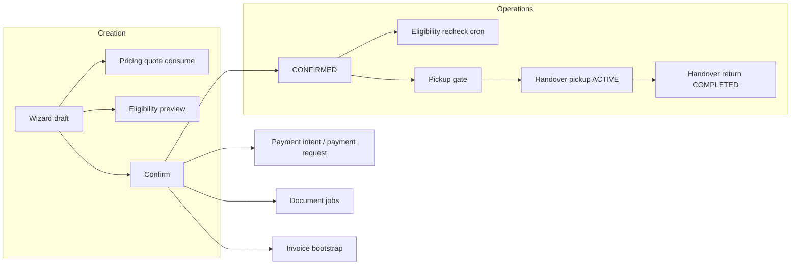

# Bookings — Current State

**As-of:** 2026-11-19 (Europe/Berlin)  
**Registry coverage status:** `AUDIT_IN_PROGRESS`  
**Epistemic default:** Code + tests **CONFIRMED** where cited; Production counts **UNKNOWN**.

## Executive summary

Rental Bookings is a large NestJS domain under `backend/src/modules/bookings/` exposing a single org-scoped REST controller with wizard, eligibility, handover, allowed-driver, and CRUD surfaces. The lifecycle couples to Pricing (quotes), Rental Rules + Customer Verification (eligibility), Rental Health (fail-closed on mutations), Payments (intents and payment requests), Documents (async bundles + legal pickup gate), and Rental Driving Analysis (detail stress + recompute). Since merge of P6-PR3 on `origin/main`, `BookingsController` requires **ACTIVE** `RENTAL` product license in addition to JWT, org scope, and permission RBAC.

## Audited baselines

| Baseline | SHA / ref | Notes |
|----------|-----------|--------|
| Repository | `origin/main` → `41fd912aacbefeb20ec238bc481b5505f943b65e` | Includes P6-PR3 rental product license on BookingsController |
| Production `/opt/synqdrive/current` | `1e6a267c8c7951e2a11633e89ab96714844ea846` | Bookings source present; **drift** from main |
| Production health | `https://app.synqdrive.eu/api/v1/health` | `ok` @ 2026-11-19 |

## End-to-end lifecycle (repository)

### Status machine (`BookingStatus`)

`PENDING` → `CONFIRMED` → `ACTIVE` → `COMPLETED`; branches `CANCELLED`, `NO_SHOW`. Matrix tests: `booking-lifecycle-status.matrix.spec.ts`, `booking-lifecycle-runtime.spec.ts`.

### Wizard

- **Draft:** `POST/PATCH .../wizard-draft` — quote attachment, customer/vehicle/station selection.
- **Checkout context:** `GET .../checkout-context` — server-side amounts, deposit, payment eligibility (`booking-wizard-checkout-context.service.ts`).
- **Confirm:** `POST .../confirm` — idempotent when already confirmed; triggers payment flow, invoice lifecycle, document dispatch, eligibility decisions.
- **Abort:** `POST .../abort` — discards draft path.

### Eligibility

- **Engine:** `BookingRentalEligibilityService` evaluates rental rules + customer inputs.
- **Gatekeeper:** `BookingEligibilityGatekeeperService` — preview (`eligibility-check`, wizard preview) and enforce on confirm/pickup.
- **Manual approval / decisions:** append-only `BookingEligibilityApproval` / `BookingEligibilityDecision` with permission modules `booking-eligibility` and `booking-eligibility-override`.
- **Retroactivity:** `booking-eligibility-recheck` + cron `*/30 * * * * *` with leader guard — rule publish and booking mutations re-evaluate without silent auto-cancel of confirmed contracts (see supporting doc).

### Payments coupling

- Wizard sets `paymentIntent` (`BookingPaymentIntent` enum) and `paymentStatus`.
- `booking-wizard-payment-flow.service.ts` — idempotency keys `wizard-confirm:{bookingId}:payment-request|checkout`.
- Separate controller: `BookingPaymentRequestController` (also RENTAL licensed post P6-PR3).
- **Invariant:** card intent does **not** auto-`PAID` invoice (`BOOKING_PAYMENT_INTENT_VS_PAID`).

### Pickup gate and handover

- **Pickup gate module** — legal document delivery prerequisites; audit `BookingPickupGateAuditEvent`.
- **Handover** — draft JSON, pickup/return protocols, station scope tests; pickup idempotent when already `ACTIVE` with protocol.
- Workflow events use idempotency keys (`booking.returned:`, `booking.completed:`).

### Allowed drivers

- `BookingAllowedDriver` rows; RBAC via `booking-allowed-drivers.policy.ts` (read vs manage by membership role).
- Primary driver patch route separate from allowed-driver list.

### Driving analysis integration

- Detail includes usage/stress via `booking-detail-usage-stress.util.ts` (RDA consumer).
- `BookingsService` triggers `RentalDrivingAnalysisRecomputeTriggerService` on relevant lifecycle events (P4-PR4 port pattern).
- `DrivingIntelligenceJob` relation on `Booking`; persist validation uses **P4 port** adapter in `driving-intelligence-booking-resolution/` (wired from `VehicleIntelligenceModule`, not `BookingsModule`).

### Async jobs

| Mechanism | Booking role |
|-----------|----------------|
| Bull `booking.document.generation` | Enqueue from bookings/documents integration |
| `BookingDocumentGenerationJob` | Durable rows + idempotency |
| Eligibility recheck cron | In-process scheduler, not Bull |
| Payment email outbox | Indirect via payment requests |

### Authorization stack (`BookingsController`)

1. `OrgScopingGuard` — `:orgId` vs JWT org.
2. `ProductLicenseGuard` + `@RequireProduct(RENTAL)` — ACTIVE product only (P6-PR3).
3. `RolesGuard`
4. `PermissionsGuard` — `bookings` read/write/manage; eligibility routes use `RequireBookingEligibilityPermission`.

### Frontend consumers

| Surface | Entry |
|---------|--------|
| Rental SPA | `bookings`, `new-booking`, `vehicle-bookings` views; `BookingDossier` tabs |
| Operator | `/operator/bookings/:bookingId` deep links and sheets |
| API client | `frontend/src/lib/api.ts` → `api.bookings.*` |

### Persistence (selected)

- **Aggregate:** `bookings` with org, customer, vehicle, stations, financials, `status`, `paymentIntent`, `paymentStatus`.
- **Satellites:** quotes consumed, price snapshots, handover protocol/draft, payment requests, eligibility approval/decision, pickup gate audit, allowed drivers, link to `rental_driving_analyses` and `driving_intelligence_jobs`.

### Idempotency and concurrency (confirmed patterns)

- Wizard confirm replay; handover pickup replay; advisory lock on vehicle overlap; payment bootstrap keys; document job idempotency keys; eligibility business audit idempotency keys.

### Architectural boundary notes (P4)

- **CONFIRMED:** DI job repository uses booking resolution port implemented under `bookings/`.
- **INFERRED gap:** Some Core VI paths may still touch `booking` / handover tables directly — documented as out of scope in P4 final audit (`NEEDS_FURTHER_EVIDENCE` for full independence).
- **INFERRED gap:** `DocumentsController` booking routes not in `RENTAL_PRODUCT_LICENSED_CONTROLLERS` — product license parity **UNKNOWN**.

## Configuration and feature flags

Booking payment requests and org payment features depend on payments module flags and org configuration — exhaustive flag inventory **not** completed in bootstrap; see Payments authority (still `NOT_STARTED`).

## Current limitations (explicit)

- No `AUTHORITY_ACTIVE` promotion.
- Production table counts and PM2/process topology not fully captured.
- Operator booking sheet vs rental wizard operational availability cutover partially documented in `VEHICLE_OPERATIONAL_STATE_BOOKING_CUTOVER_P1_6` — full operator parity **UNKNOWN**.

## Non-claims

- No claim that Production behaves identically to `origin/main` while SHA drift exists.
- No claim of production-validated eligibility or payment flows in this audit.
- No claim that all adjacent HTTP routes enforce RENTAL product license.

## Last verified evidence

- Repository file inspection 2026-11-19
- Production SSH + health 2026-11-19 (`evidence/PRODUCTION_BASELINE.md`)