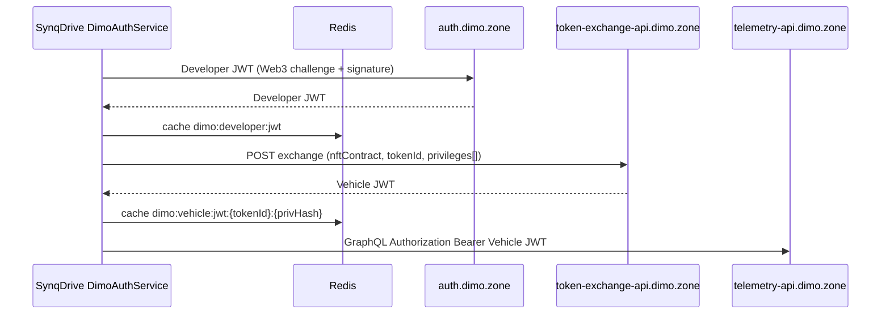

# R1 — Authentication, consent, and vehicle identity

| Audit head | `0633d08311803b1473c6e7a274e5074e4cb69a08` |
|------------|---------------------------------------------|

## Auth chain (CONFIRMED_FROM_CODE)

**Config surface:** `backend/src/config/dimo.config.ts`

| Endpoint | Default |
|----------|---------|
| Identity | `DIMO_API_URL` → `https://identity-api.dimo.zone` |
| Auth | `https://auth.dimo.zone` |
| Token exchange | `DIMO_TOKEN_EXCHANGE_URL` → `https://token-exchange-api.dimo.zone` |
| Telemetry GraphQL | `DIMO_TELEMETRY_API_URL` → `https://telemetry-api.dimo.zone/query` |

## `getVehicleJwt(tokenId, privileges = [1,2,3,4,5,6])`

Source: `backend/src/modules/dimo/dimo-auth.service.ts` L387+

| Aspect | Behavior |
|--------|----------|
| Default privileges | `[1,2,3,4,5,6]` — full standard set unless caller overrides |
| Cache key | Redis + in-memory fallback; keyed by `tokenId` + hash of sorted privilege list |
| Concurrency | Redis lock `dimo:vehicle:jwt:lock:{tokenId}:{privHash}` — TTL 30s, up to 10 retries @ 500ms |
| TTL | `DIMO_VEHICLE_JWT_TTL_SECONDS` default **300**; refresh margin **60** |
| Developer JWT | Separate cache key `dimo:developer:jwt`; used for admin/triggers/identity ops |

### Privilege-to-consumer matrix (INFERRED + partial CONFIRMED)

Official privilege semantics should be verified against DIMO Identity docs (**UNKNOWN** in R1 — DIMO MCP auth timed out). SynqDrive **observed** usage:

| Privilege set | Typical callers | Data accessed |
|---------------|-----------------|---------------|
| Default `[1..6]` | `DimoTelemetryService`, most GraphQL fetches | Broad telemetry + location history classes |
| Custom subsets | Battery preflight, tire audits, scripts | Narrower queries (grep `getVehicleJwt(` for call sites — **53** files) |

**Failover:** On exchange failure, stats increment `consecutiveFailures`; no silent downgrade to unauthenticated provider calls in gateway path (executor throws/returns error upstream).

**Partial privileges:** Supported at API level via `privileges` argument; **not** systematically enforced per-query in builders — static field lists may request data outside granted privileges → provider 403 (**INFERRED**).

## Vehicle identity mapping

| Concept | SynqDrive storage / code |
|---------|---------------------------|
| DIMO `tokenId` | `Vehicle` link fields + webhook payload resolution |
| ERC721 DID | `did:erc721:137:{contract}:{tokenId}` in triggers service |
| VIN | Identity / attestation paths (on-demand Q004 patterns — Phase 2A) |
| SynqDrive `vehicleId` | Prisma; mapping via `DimoVehicleDataSourceLink` / consent |

**Consent / offboarding:** Device-connection episodes + link service; former-fleet exclusion documented (tokenId **190497** — historical evidence). Stale scheduler mirror **DIM-GAP-005** remains open.

## Multi-tenant isolation

Developer license credentials are **deployment-level** (`DIMO_CLIENT_ID` / `DIMO_PRIVATE_KEY`), not per-tenant. Tenant isolation is enforced at **SynqDrive vehicle/org mapping**, not separate DIMO developer licenses per org (**CONFIRMED_FROM_CONFIG**).

## Verification gaps (R1)

| Gap | Safe verification |
|-----|-------------------|
| Numeric privilege ID → capability name matrix | DIMO Identity API docs + MCP when available |
| Per-tenant multiple developer licenses | Production env + console audit (read-only) |
| Token revocation behavior | Controlled 401 replay in staging |
