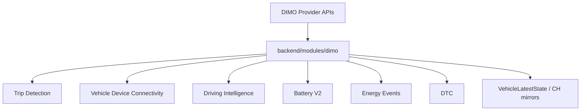

# R1 — Cross-module consumer graph

## Principle

**DIMO Integration** owns provider transport, auth, normalization of provider payloads, webhook ingress, and segment/telemetry **fetch**. Domain decisions (trip boundaries, scores, health conclusions) stay with each module authority.

## Consumer map (high level)

| Consumer module | DIMO inputs | DIMO-owned artifacts |
|-----------------|-------------|----------------------|
| Trip Detection & Lifecycle | Segments Q022, live Q006–Q008, R9 wake | Webhook → wake handoff only |
| Vehicle & Device Connectivity | OBD plug webhooks, episodes | Inbox + reconciliation |
| Driving Intelligence / EXP-021 | HF Q009, events Q015, reference capture | Transport via telemetry service |
| Battery V2 | Q020 preflight, crank Q012, snapshot subsets | Signal normalizers in dimo mappers |
| Energy Events / RFRF | Q023/Q025 segments, fuel signals | Segment clients |
| Tankstellenerkennung | Refuel segments / fuel level contexts | Q013/Q014 family |
| DTC / Vehicle Health | Q005, webhook `obdDTCList` | DTC processor |
| Tire / Brake health | Snapshot + history queries | Audit scripts + health services |
| Master / Rental UI | Indirect via APIs | No direct GraphQL |

## Neighbor authorities (mandatory cross-read)

| Module | Registry status |
|--------|-----------------|
| Trip Detection & Lifecycle | AUTHORITY_ACTIVE |
| Vehicle & Device Connectivity | AUTHORITY_ACTIVE |
| Driving Intelligence | AUDIT_IN_PROGRESS |
| Battery V2 | AUTHORITY_ACTIVE |
| Scaling Process | AUTHORITY_ACTIVE |

R1 updated **DIMO Integration only**; neighbor rows unchanged unless cross-linked.
