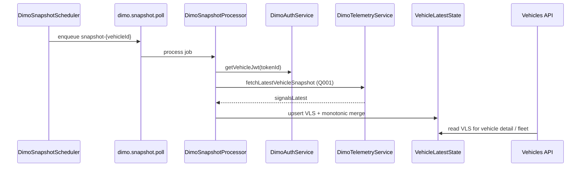
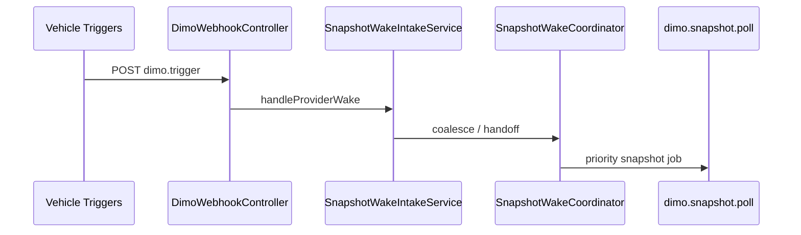

# R2 — End-to-end consumer traces

## 1. Snapshot → VLS → UI

**Authority:** DIMO transport + normalization; VDC/UI read models own presentation rules.

## 2. Webhook speed/ignition → wake → snapshot

**Authority:** Trip Detection owns wake semantics; DIMO owns ingress.

## 3. Segments → trip boundaries

`DimoSegmentsService.fetchTripSegments*` (Q022) → Trip Detection orchestration / reconciliation. **Trip Detection** owns canonical boundaries (TDL-OQ-006).

## 4–14 (index)

| # | Flow | DIMO role | Domain owner |
|---|------|-----------|--------------|
| 4 | HF Q009 | `DimoSegmentsService.fetchHighFrequencyData` | Driving Intelligence |
| 5 | Events Q015 | `fetchDrivingEvents*` | DI / brakes intake |
| 6 | Refuel Q023 | `buildEnergyEventSegmentsQuery` | Energy Events |
| 7 | Recharge Q025 | `DimoRechargeSegmentsClient` | Battery / EED |
| 8 | Crank Q012 | `fetchBatteryCrankWindow` | Battery V2 |
| 9 | OBD plug | Webhook → device connection inbox | VDC |
| 10 | DTC Q005 | Processor + webhook | DTC module |
| 11 | Identity | `dimo-api-sync`, `fetchVehicleVin` | Vehicle onboarding |
| 12 | GPS | Q001/Q002 location fields | Fleet map |
| 13 | Tire pressures | Q001 snapshot normalizer | Tire health |
| 14 | R9 wake | See diagram 2 | Trip Detection |

Cross-authority conflicts: register in `contradictions/` — do not overwrite neighbor docs.
