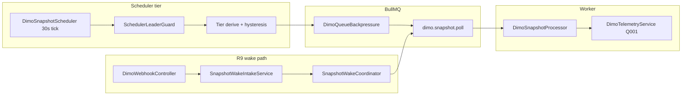

# R1 — Polling, wake, and scheduler architecture

## End-to-end flow

## Defaults (CONFIRMED_FROM_CODE)

| Knob | Default | Source |
|------|---------|--------|
| Scheduler tick | 30s | `WORKER_SNAPSHOT_INTERVAL_MS` / `@Interval` |
| ACTIVE_DRIVING | 30s | `WORKER_SNAPSHOT_TIER_ACTIVE_DRIVING_MS` |
| RECENTLY_ACTIVE | 60s | `WORKER_SNAPSHOT_TIER_RECENTLY_ACTIVE_MS` |
| RESTING_STANDBY | 5 min | `WORKER_SNAPSHOT_TIER_RESTING_STANDBY_MS` |
| LONG_IDLE | 30 min | `WORKER_SNAPSHOT_TIER_LONG_IDLE_MS` |
| Activity-tier polling | enabled | `WORKER_SNAPSHOT_ACTIVITY_TIER_POLLING_ENABLED` |
| Legacy fixed cadence rollback | `WORKER_SNAPSHOT_LEGACY_FIXED_CADENCE=true` | Enqueues all eligible every tick |

**Production @ R1:** `WORKER_SNAPSHOT_ACTIVITY_TIER_POLLING_ENABLED` **name present** on VPS; numeric tier overrides **not observed** in sanitized grep → **defaults likely** (**INFERRED**).

## Promotion / demotion

Canonical: `derive-snapshot-polling-tier.ts` + hysteresis in `applySnapshotPollingHysteresis`. Authoritative activity signals can promote tier; demotion hold via `WORKER_SNAPSHOT_ACTIVE_DRIVING_DEMOTION_HOLD_MS`.

**Eligibility cohort:** CONNECTED vehicles with `tokenId` (pre-P1.2 comment in scheduler). OFFLINE recovery **not** owned by snapshot scheduler.

## Job identity & deduplication

- `jobId = snapshot-<vehicleId>` — prevents pile-up; removes stale waiting jobs each tick (see scheduler header comment).
- Wake path coalesces via Trip Detection / `SnapshotWakeCoordinator` (cross-module).

## Multi-replica

`SchedulerLeaderGuardService` — only leader runs scheduler ticks (**Scaling Process** owns algorithm; DIMO consumes).

## Theoretical load (labelled THEORETICAL)

Assuming ACTIVE_DRIVING 30s tier for all vehicles, Q001 only:

| Fleet size | Q001 calls/day (2/min/vehicle) |
|------------|--------------------------------|
| 5 | 14,400 |
| 50 | 144,000 |
| 500 | 1,440,000 |
| 5,000 | 14,400,000 |

Active-trip parallel queries (Q006–Q008) add **order-of-magnitude** load during trips — see Phase 2A §22 (**HISTORICAL** models).

## APDS / hardware standby

**CONTRADICTED risk:** Frequent SynqDrive polls do not imply fresh hardware samples. `providerFetchedAt` may update while signal values are stale — consumer modules must use freshness semantics (VDC, Battery V2, Trip FSM).
