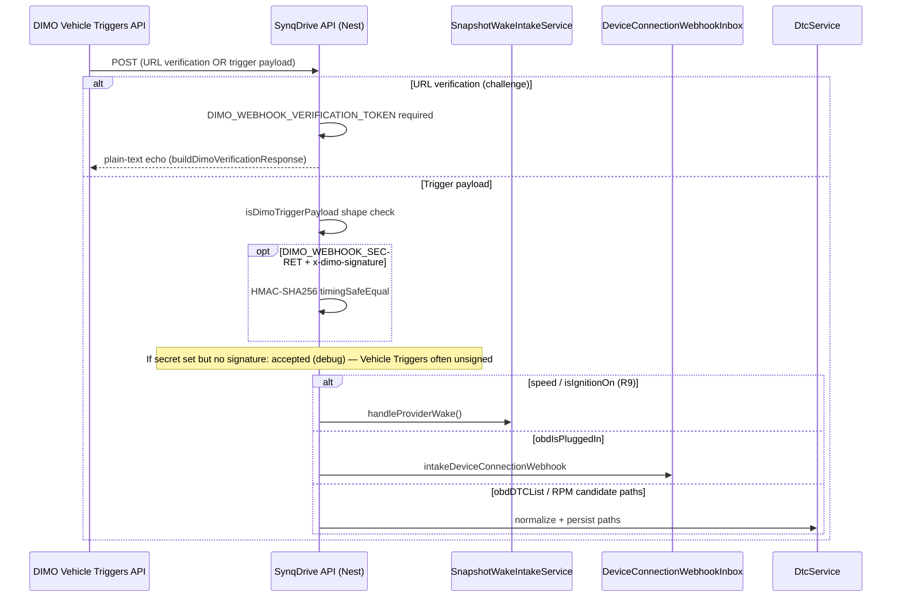

# R1 — Webhook and trigger architecture

| Field | Value |
|-------|-------|
| **Audit head** | `0633d08311803b1473c6e7a274e5074e4cb69a08` |
| **Official provider doc fetched** | `https://dimo.org/docs/api-references/vehicle-triggers-api` @ **2026-10-11** |

## Ingress: SynqDrive `DimoWebhookController`

**Route:** `POST /webhooks/dimo` (`backend/src/modules/dimo/dimo-webhook.controller.ts`)

### Trust chain (CONFIRMED_FROM_CODE)

| Control | Config | Behavior |
|---------|--------|----------|
| URL verification token | `DIMO_WEBHOOK_VERIFICATION_TOKEN` | Required for handshake; **503** if missing on verification request |
| Optional HMAC | `DIMO_WEBHOOK_SECRET` + `x-dimo-signature` | Validated when both present; **not required** when absent (documented in controller) |
| Unsigned dev bypass | `NODE_ENV === 'development'` only | `allowUnsignedInDev` |
| Payload normalization | `dimo-webhook-payload.util.ts` | CloudEvents + legacy fields; `tokenId` resolution |
| Blocked signals | `isBlockedEngineWebhookSignal` | RPM/engine webhook signals ignored (policy) |

### Security findings (evidence-based, no unproven claims)

| ID | Threat | Preconditions | Impact | Evidence | Severity |
|----|--------|---------------|--------|----------|----------|
| **DIM-SEC-R1-001** | Unsigned trigger POST accepted | Attacker can reach public webhook URL; verification token not used on trigger path | Spoofed wake / connectivity events if URL exposed | Controller accepts without HMAC when secret unset or signature absent (`dimo-webhook.controller.ts` L106–128) | **MEDIUM** — mitigated by network exposure + optional secret; token is registration-time not per-POST |
| **DIM-SEC-R1-002** | Replay of trigger POST | No `event id` dedupe at controller edge for all paths | Duplicate wake/coalesce downstream | **INFERRED** — Trip Detection coalesce may absorb; not verified in R1 |
| **DIM-SEC-R1-003** | Tenant mapping via tokenId only | Wrong vehicle link row | Cross-tenant mis-routing | Prisma lookup paths in inbox/DTC — **requires per-path audit** (partial in R1) |

## Egress: provider trigger registration

### Current official API (CONFIRMED_FROM_PROVIDER_DOC @ 2026-10-11)

- Base: `https://vehicle-triggers-api.dimo.zone`
- Subscribe: `POST /v1/webhooks/:webhookId/subscribe/:tokenDID`
- Vehicle subscriptions list: `GET /v1/webhooks/vehicles/:tokenDID`
- Webhook create: rich schema (`service`, `metricName`, `condition`, `targetURL`, `verificationToken`, …)

### SynqDrive runtime code: `DimoTriggersService`

| Method | HTTP pattern | Status |
|--------|--------------|--------|
| `listWebhooks` | `GET /v1/webhooks` | **IMPLEMENTED** — aligns with docs |
| `getVehicleWebhookSubscriptions` | `GET /v1/webhooks/vehicles/{subject}` | **IMPLEMENTED** — uses ERC721 DID subject |
| `createWebhook` | `POST /v1/webhooks` body `{name, url}` | **LEGACY / CONTRADICTED** — docs require extended schema (`DIM-CX-003`) |
| `subscribeVehicle` | `POST /v1/webhooks/{id}/vehicles/{tokenId}` + `{signals}` | **LEGACY / CONTRADICTED** — docs use `/subscribe/{tokenDID}` without per-signal body (`DIM-CX-002`) |

**Classification:** `DimoTriggersService` is documented as **ops/helpers only**; Production R9 cohort was created via `backend/scripts/ops/r9-scoped-dimo-trigger-bootstrap.mjs` and related ops scripts using **current** subscribe paths (see script header L5).

### R9 wake signals (Production cohort)

Ops scripts register CEL-based webhooks (speed / ignition) with stableIds documented in historical evidence (`9eeb7158afee`, `5d611d470eab`). Runtime handler delegates to `SnapshotWakeIntakeService` (Trip Detection module).

## Cross-reference

- Operations runbook: [`operations/WEBHOOK_OPERATIONS.md`](../operations/WEBHOOK_OPERATIONS.md)
- Decision: **DIM-R9-001** in `decisions/DECISION_REGISTER.md`
- Contradictions: [`contradictions/OPEN_CONTRADICTIONS.md`](../contradictions/OPEN_CONTRADICTIONS.md) — `DIM-CX-002`, `DIM-CX-003`
