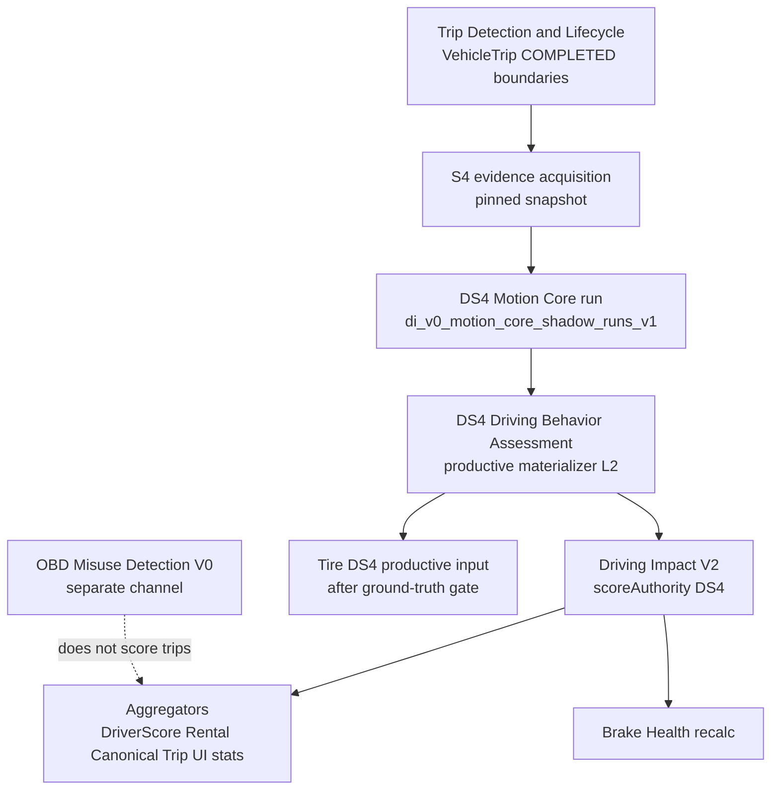

# DS4 Authoritative Driving Assessment Migration

| Field | Value |
|-------|-------|
| **Document ID** | `DI-DESIGN-DS4-AUTHORITY-MIGRATION-V1` |
| **Status** | `PROPOSED` — owner decision recorded; **no runtime activation** |
| **Owner decision** | DS4 Motion Core replaces **legacy HF/native driving behaviour assessment** as the **single authoritative** source for manoeuvre events, temporal quality, and downstream operational-load scoring. **No permanent legacy fallback.** **No parallel authoritative scoring.** |
| **Recorded** | 2026-10-28 (PR-0, docs + governance only) |
| **Production baseline (read-only)** | `51adb23499653d0f2c7774d98737a34bd615b262` |
| **Consumer audit baseline** | Driver Score & Rental Driving Analysis Consumer Audit V1 (STRICT READ_ONLY, same SHA) |
| **Related decisions** | [`DI-DEC-DS4-AUTHORITY-001`](../decisions/DECISION_REGISTER.md) |
| **Evidence** | [`evidence/CONSUMER_AUDIT_V1_FINDINGS_REGISTER.md`](../evidence/CONSUMER_AUDIT_V1_FINDINGS_REGISTER.md) |

---

## 1. Problem statement

Today, production driving behaviour assessment is **dual-path and legacy-authoritative**:

- **HF SMART5** whole-trip enrichment (`trip.behavior.enrichment`) writes `TripBehaviorEvent` and `VehicleTrip` counters.
- **LTE_R1 native** events write `DrivingEvent` and mirror counters.
- **Driving Impact V1** (`v1.2.0`) aggregates HF-derived per-100 km rates into `TripDrivingImpact.drivingStressScore` and rolling `VehicleDrivingImpactCurrent`.

**DS4 Motion Core** (`di_v0_motion_core_shadow_runs_v1`) already produces post-trip manoeuvre events, FSM coverage, and speed authority on an allowlisted fleet, but remains **shadow-only** with **zero** writes to `trip_driving_impact`, `vehicle_trips` driving counters, or `trip_behavior_events`.

Consumers (DriverScore, RentalDrivingAnalysis, rolling current, Trip UI) read legacy impact rows **without** consistent `analysisStatus` gates and **with** unsafe `vehicle_trip_compat` fallbacks — documented in Consumer Audit V1.

---

## 2. Target authority model

### 2.1 Single authority chain (dependency graph)



**Layer rules**

| Layer | Owns | Does not own |
|-------|------|----------------|
| Trip boundaries | Trip Detection / DIMO Segments | — |
| Manoeuvre kinematics | DS4 Motion Core (accel/decel events, FSM, speed series) | Trip start/end |
| Trip assessment | DS4 Assessment materializer (status, completeness, channel summaries) | Composite 0–100 score |
| Operational load | Driving Impact V2 on DS4 inputs only | HF point-pair detectors |
| Misuse (OBD) | Separate misuse pipeline on pinned OBD + rules | Driving stress score authority |

### 2.2 Fail-closed contract (non-negotiable)

| Rule | Requirement |
|------|-------------|
| **FC-1** | Insufficient or inadmissible DS4 evidence ⇒ **explicit** status (`INSUFFICIENT_EVIDENCE`, `UNSUPPORTED`, `PENDING`, `FAILED`) — **never** a numeric score presented as measured. |
| **FC-2** | **No legacy fallback** after cutover: aggregators **must not** read `LEGACY_HF_V1` rows or `VehicleTrip.drivingScore` when DS4 authority mode is active. |
| **FC-3** | **No fabricated zeros**: missing events ⇒ `null` score and zero counts **only** where semantically “no admissible events”, not as a substitute for unavailable assessment. |
| **FC-4** | **No mixed aggregation**: a single query/window uses **one** `scoreAuthority`; partial DS4 coverage ⇒ window-level `INSUFFICIENT_EVIDENCE`, not legacy top-up. |
| **FC-5** | **Provenance retained**: every persisted score row carries `scoreAuthority`, `modelVersion`, `bundleVersion`, `speedAuthority`, `combinedInputIdentity`, `pinnedSnapshotHash` (or successor fields). |
| **FC-6** | **Non-destructive history**: legacy rows remain immutable; additive columns/backfill labels only; no automatic destructive backfills. |
| **FC-7** | **Non-driving telemetry unaffected**: battery, fuel, DTC, routes, trip FSM, energy events — out of scope; productive-isolation specs required before any DS4 productive write path. |

---

## 3. DS4 outputs vs legacy replacement map

| Legacy producer | Legacy persist | DS4 replacement | Gap |
|-----------------|----------------|-------------------|-----|
| `hf-acceleration/braking/abuse` | `TripBehaviorEvent`, counters | DS4 `ACCELERATION`/`DECELERATION` events + assessment summaries | OBD abuse types **not** in DS4 motion (→ Misuse V0) |
| `lte-r1-behavior-enrichment` | `DrivingEvent` | DS4 manoeuvres (R1 speed stripped pre-kinematics) | Native DIMO behaviour channel remains fail-closed |
| `driving-impact-scorer` V1 | `TripDrivingImpact` | Impact V2 scorer on assessment L2 | Weights/thresholds for DS4 inputs **not yet defined** (B4) |
| Misuse rules on HF/native | `MisuseCase` | Manoeuvre subset from DS4 + **OBD Misuse V0** | B1 |

**Intensity fields** (`meanAccelMps2`, `durationS`, `steps`, `coverageRatio`, `startUncertaintyS`, `endUncertaintyS`) were **IN_MEMORY_ONLY** at PR-0. **PR-2** persists them on shadow event rows under event-row contract `DI_V0_MOTION_CORE_EVENT_ROW_V2_INTENSITY_ORDINAL_V1` (ordinal-only policy, peaks excluded, legacy rows resolve as V1 with `intensity=null`; bundle versions/intent keys unchanged) — see [`evidence/DS4_EVENT_INTENSITY_PERSISTENCE_PR2.md`](../evidence/DS4_EVENT_INTENSITY_PERSISTENCE_PR2.md). Authoritative intensity use remains gated on Fable review (`DI-DEC-DS4-INTENSITY-PERSIST-001`, PROPOSED).

---

## 4. OBD misuse vs DS4 motion scoring (separation)

**DS4 Motion Core** authority covers **kinematic manoeuvres** from position-derived speed (C4/C5.1) and FSM temporal structure.

**OBD misuse detection** (engine thermal, cold-start abuse, kickdown/launch heuristics, shutdown-while-moving claims) is a **separate evidence channel**:

- Inputs: pinned S4 **R1 OBD** five-field channel (`DI_V0_R1_OBD_QUERY_V0_3`) + position speed context — **INTERVAL_ONLY** time semantics; no exact-time customer claims without independent proof.
- Outputs: misuse cases / watchpoints — **not** blended into `drivingStressScore`.
- Legacy `hf-abuse.ts` retirement is gated on **PR-M** (shadow validation) or explicit owner acceptance of reduced misuse coverage (**B1**).

R1 temporal containment remains as **presentation/marker** policy where historical legacy rows are displayed; DS4 path inherits R1 speed strip at kinematics boundary.

---

## 5. Consumer Audit V1 findings (preserved)

Full register: [`evidence/CONSUMER_AUDIT_V1_FINDINGS_REGISTER.md`](../evidence/CONSUMER_AUDIT_V1_FINDINGS_REGISTER.md).

Summary: **0× P0**, **4× P1**, **4× P2**, **2× ADDENDUM** — each mapped to PR-1…PR-7 acceptance criteria in that register.

---

## 6. Technical blockers B1–B9

| ID | Blocker | Resolution path | Owning PR |
|----|---------|-----------------|-----------|
| **B1** | No DS4 OBD abuse detectors | PR-M shadow misuse V0 on pinned OBD; or owner decision to drop dimensions | PR-M / PR-10 gate |
| **B2** | Intensity not persisted | Extend persisted event row; ordinal-only use (B3). **PR-2 implemented** (Draft, not deployed): event-row contract V2 persists six fields for new runs; historical rows stay V1 (no backfill). Residual: Fable review of contract + ordinal restriction; consumers may not bind before review | PR-2 |
| **B3** | Fleet admission / allowlist / C5.1 Tesla-Tiguan only | G2 fleet admission policy; UNSUPPORTED outside admission | PR-3 + cutover gates |
| **B4** | No DS4 Impact V2 score model | Define weights; Fable review; shadow mode compare | PR-4 |
| **B5** | Assessment latency (S4 quiet + outbox) | PENDING UI; rental recompute on arrival | PR-6, PR-7 |
| **B6** | Brakes / Rental / Rental Health registry NOT_STARTED | PR-0 → AUDIT_IN_PROGRESS manifests | PR-0 (this), PR-6, PR-8 |
| **B7** | Tire ground truth sparse | PR-9 only after measurement gate | PR-9 |
| **B8** | C5.1 generalization (four drives) | Document limitations; per-OEM admission | PR-2 rollout policy |
| **B9** | STALE→READY mapping + SKIPPED/PARTIAL drift | PR-1 enum/mapping fix | PR-1 |

---

## 7. Historical data and provenance

| Artifact | Policy |
|----------|--------|
| `trip_driving_impact` (pre-cutover) | Label `scoreAuthority=LEGACY_HF_V1` (additive column, PR-4); values unchanged |
| `trip_behavior_events`, `driving_events`, counters | Retained immutable; historical Trip UI may show labelled legacy markers pre-cutover timestamp |
| `rental_driving_analyses` | Supersede on recompute; never delete |
| `vehicle_driving_impact_current` | On DS4 cutover, recompute from DS4 rows only; archive prior rolling snapshot |
| Replay | Owner-authorized only; from pinned S4 snapshots; new assessment rows — never overwrite legacy |
| Backfill tooling | `trip-driving-impact-backfill.service` frozen to legacy authority |

---

## 8. Migration PR sequence (reference)

| PR | Title | Runtime? |
|----|-------|----------|
| **PR-0** | Authority + migration design (this document) | **No** |
| PR-1 | Consumer audit remediation (legacy path safety) | Yes (read gates) |
| PR-2 | DS4 persisted event intensity — **implemented (merged #2209; event-row contract V2)** | Yes (shadow payload only) |
| **PR-A** | Assessment L2 + Impact V2 persistence (`di_v0_ds4_trip_assessment_v1`, `di_v0_ds4_trip_driving_impact_v2`; worker OFF) | Yes (non-productive default) |
| PR-3 | DS4 assessment materializer L2 (superseded by PR-A implementation path) | Flagged OFF default |
| PR-4 | Impact V2 + `scoreAuthority` + SHADOW mode | Flagged |
| PR-5 | Aggregator authority switch | Mode flag |
| PR-6 | Rental + bookings + BI | Mode flag |
| PR-7 | Trip UI DS4-only markers | UI |
| PR-8 | Brakes on DS4 impact | Mode flag |
| PR-9 | Tires productive DS4 input | After B7 |
| PR-10 | Legacy producer decommission | After gates G1–G9 |
| PR-M | OBD misuse V0 shadow | Parallel |

**Cutover gates G1–G9** and **rollback levels** are defined in the planning baseline communicated to owner (2026-10-28); evidence bundles attach at PR-4/PR-5 shadow phase.

---

## 9. Cross-module authority touchpoints

| Module | Registry before PR-0 | PR-0 action |
|--------|----------------------|-------------|
| Driving Intelligence | `AUTHORITY_ACTIVE` | Decision + this design doc + consumer findings register |
| Tires Health | `AUDIT_IN_PROGRESS` | Close `TIRE-GAP-DI-GRAPH-NO-DS4-NODE-001` → **PARTIALLY_CLOSED** (DI graph node in design; graph YAML follow-up in PR-1+) |
| Brakes Health | `NOT_STARTED` | → `AUDIT_IN_PROGRESS` bootstrap |
| Rental Driving Analysis | `NOT_STARTED` | → `AUDIT_IN_PROGRESS` bootstrap |
| Rental Health | `NOT_STARTED` | → `AUDIT_IN_PROGRESS` bootstrap |
| Trip Detection & Lifecycle | `AUTHORITY_ACTIVE` | Unchanged — boundary owner |
| Automatic Trip Enrichment | `AUTHORITY_ACTIVE` | Future PR-10 coordinates enqueue retirement |

**No `AUTHORITY_ACTIVE` promotion** for DS4 productive paths in PR-0.

---

## 10. Validation commands (PR-0)

```bash
bash architecture/scripts/validate-module-registry.sh
bash architecture/drivingintelligence/scripts/validate-graph.sh
bash architecture/drivingintelligence/scripts/validate-docs.sh
```
