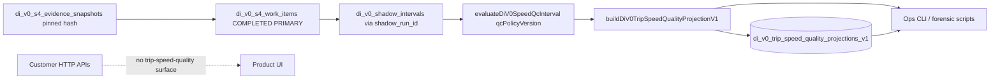

# EXP021 — P1 V2 runtime integration readiness (2026-10-14)

**Epistemic:** CONFIRMED (repository trace + Production read-only SHA)  
**Decision:** PROPOSED activation path — ops explicit `qcPolicyVersion` only; no customer default flip  
**Production mutations:** NONE (this document)

## Merge verification (`origin/main`)

| PR | Merge commit (on main) | Scope |
|----|------------------------|--------|
| #2020 | `8152d313d1` | P2.1 R3/R3A/R3B GPS/QC forensic (read-only) |
| #2021 | `f7a285b59f` | P1 speed QC policy V2 (opt-in stationary null-speed) |
| #2025 | `72eaaf3d5e` (merge) | P1 V2 multi-trip regression / evidence closure |

**`CURRENT_MAIN_SHA`:** `72eaaf3d5e066adb5f0f05220196a4a1141d392f`

## Production deploy observation (read-only SSH)

| Field | Observed |
|-------|----------|
| Release path | `/opt/synqdrive/releases/20261014153314_v4994` |
| **`ACTUAL_PRODUCTION_SHA`** | `a4c3b1fc1de0480d7caab5897242b67bb3f7044e` |
| `f7a285b59f` ancestor of prod? | **NO** → `V2_CODE_DEPLOYED=NO` |
| `DI_V0_SPEED_QC_POLICY_V2` in prod policy file | **0** occurrences |

Do **not** infer deploy from `main` merge alone.

## Data path (repository, customer vs ops)

| Stage | Component | V2 today? | Customer path? |
|-------|-----------|-----------|----------------|
| Acquisition | S4 snapshot pin on work item | N/A | Indirect (S4 shadow pipeline when enabled) |
| Shadow / S1 | `di_v0_shadow_intervals` | N/A | Same |
| P1 QC | `evaluate-di-v0-speed-qc-interval.ts` | **Only if caller passes `qcPolicyVersion=V2`** | No automatic caller |
| P2 build | `build-di-v0-trip-speed-quality-projection.v1.ts` | Same opt-in | No |
| P2 engine | `computeDiV0TripSpeedQualityProjectionV1ForWorkItem` | Opt-in on input | No scheduler wiring |
| Persist | `DiV0TripSpeedQualityProjectionService.projectForWorkItem` | **After integration PR: opt-in `{ qcPolicyVersion }`**; default V1 | **Not wired** — module not in AppModule |
| Read | `readCurrentOpsProjection(org, trip, policy?)` | Policy-scoped row; default V1 | Ops-only DTO `toDiV0TripSpeedQualityOpsReadV1` |
| Preview | `previewDiV0TripSpeedQualityForWorkItem` + ops CLI | **CLI `--qcPolicyVersion` / `DI_V0_P21_QC_POLICY_VERSION`** | Read-only, no persist |
| Forensic | `exp021-p21-p1-v2-policy-compare*.ts` | Explicit V1/V2 compare | No |
| API / UI | — | — | **No** `trip-speed-quality` frontend references |

## Policy selection points (`CURRENT_POLICY_SELECTION_POINTS`)

1. **Default:** `DI_V0_SPEED_QC_DEFAULT_POLICY_VERSION` → V1 (`di-v0-speed-qc-policy.version.ts`).
2. **P1 evaluator:** `input.qcPolicyVersion` → `resolveDiV0SpeedQcPolicyVersion`.
3. **P2 builder / engine / preview:** optional `qcPolicyVersion` on compute input (default V1).
4. **Persist service:** optional `projectForWorkItem(..., { qcPolicyVersion })` (default V1).
5. **Ops read:** `readCurrentOpsProjection(..., qcPolicyVersion?)` (default V1).
6. **Ops preview CLI:** `--qcPolicyVersion` or `DI_V0_P21_QC_POLICY_VERSION`.
7. **Forensic compare:** hard-coded dual run V1 + V2 in memory.

**Implicit V1 callers:** any path omitting `qcPolicyVersion` (including historical persisted rows labeled V1).

## Storage, cache, coexistence

- **Computed on write** when ops calls `projectForWorkItem`; not recomputed on customer API read (no customer API).
- **Idempotency key** includes `qcPolicyVersion` (`di-v0-trip-speed-quality-idempotency.ts`) → V1 and V2 **CURRENT** rows can coexist per trip when both projected.
- **Unique scope:** `(organization_id, trip_id, qc_policy_version, projection_version)` for CURRENT lifecycle.
- **Provenance:** `projection.identity.qcPolicyVersion` and `provenance.qcPolicyVersion` on stored JSON.

## Gap before customer-facing V2

1. **Deploy** release containing #2021+ (#2025) to Production.
2. **Explicit ops choice** of V2 on preview and/or persist calls.
3. **Optional future:** scheduler hook after S4 PRIMARY completion with configured policy (out of scope here).
4. **Product surfacing:** UI/API contract not implemented — user-visible trip metrics unchanged.

## Smallest integration change (this PR)

Wire `qcPolicyVersion` through **persist service** and **preview CLI** (engine/preview library already supported). No default flip; no S1/S2/calibration changes.

## Rollback

- Omit `qcPolicyVersion` or pass V1 on ops calls.
- V2 CURRENT rows remain in DB but are not read unless `readCurrentOpsProjection(..., V2)` is used.

## Related evidence (closed — do not re-run)

- `EXP021_P1_V2_STATIONARY_SEMANTICS.md`
- `EXP021_P1_V2_MULTI_TRIP_EVIDENCE_CLOSURE.md`
- Frozen manifest `evidence/data/EXP021_P1_V2_MULTI_TRIP_MANIFEST_FROZEN_V1.json`
