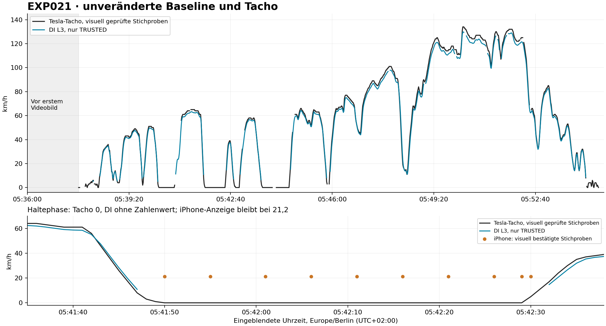

# DI EXP021 – Videoabgleich der unveränderten Baseline

Stand: 16.10.2026. Referenzfahrt 358d0158-b2a9-47ed-af26-33926c5770b4, Tesla Model 3, DIMO Software-Integration. Auswertung des eingefrorenen Pre-Deploy-Replays. Kein Produktionszugriff, kein Algorithmus-Tuning und keine Aussage über einen inzwischen erfolgten Deploy.

## Ergebnis

Die numerische GPS-L3-Rekonstruktion folgt dem Tacho in den auswertbaren Fahrabschnitten eng. Der größere Untersuchungsbedarf betrifft die Abdeckung bei Halten, Rangieren und Übergängen sowie die Herkunft der frühen Fahrtgrenze. Das iPhone-Overlay eignet sich nicht durchgehend als aktuelle Geschwindigkeitsreferenz: Bei Tacho 0 bleiben beispielsweise 11,7 beziehungsweise 21,2 km/h angezeigt. Ein pauschales Tuning gegen dieses Overlay würde falsche Ziele setzen.

| Vergleich DI minus Tacho | Ergebnis |
| --- | ---: |
| Gepaarte, eindeutige Sekunden mit TRUSTED DI und lesbarem Tacho | 748 |
| Mittlere Differenz | −2,07 km/h |
| Mittlere absolute Differenz | 2,30 km/h |
| Median der absoluten Differenz | 2,14 km/h |
| 90%-Quantil der absoluten Differenz | 4,02 km/h |
| 95%-Quantil der absoluten Differenz | 4,49 km/h |
| Größte absolute Differenz in dieser Stichprobe | 6,08 km/h |

Das sind deskriptive Referenzdifferenzen, keine kalibrierten Fehler gegenüber wahrer physischer Geschwindigkeit. Tacho-Bias, Anzeigelatenz, Zeitquantisierung und GPS-Modellierung sind nicht getrennt identifiziert. Insbesondere keine pauschale Addition von 2,07 km/h empfehlen. Benachbarte DI-Werte und die untersuchten Zeitfenster sind nicht unabhängig.

## Provenienz und tatsächlicher Prüfumfang

Alle sechs Original-MOV-Dateien wurden heruntergeladen, unverändert erhalten und lokal mit SHA-256 gehasht. Die Größen stimmen mit den Drive-Metadaten überein. Ein unabhängiger serverseitiger SHA-256 stand nicht zur Verfügung. Namen, Größen, vollständige Hashes, Drive-IDs, Containerzeiten und Framedaten stehen in PROVENANCE_REVIEW.json.

TC_00062 bis TC_00067 ergeben zusammen 1.027,588333 Sekunden Videodauer. Jeweils H.264, 1280×720 codiert, durch Rotation als 720×1280 dargestellt. Insgesamt 25.679 Frames. Nominal etwa 25 fps, tatsächlich überwiegend 40 ms und vereinzelt 41,666/41,667 ms zwischen Presentation-Timestamps. Deshalb kein blindes Frameindex/25 als Zeitbasis.

Systematisch wurde jeder 25. Frame extrahiert: 1.028 reale Frames über alle sechs Dateien, ungefähr ein Frame pro Sekunde. Sämtliche Tacho-Kandidaten wurden visuell geprüft, unklare Fälle erneut im größeren Bildausschnitt. 975 Frames lieferten lesbare Tacho-Werte, 53 bleiben unbekannt. Wegen zweier doppelter Uhrlabels ergeben sich 1.026 eindeutige Video-Sekunden und 973 eindeutige Sekunden mit lesbarem Tacho. Zusätzlich wurden 30 Frames im Abstand von fünf Frames aus den ersten sechs Sekunden geprüft; diese überlappen teilweise mit der Grundstichprobe.

Das ist eine systematische zeitliche Stichprobe mit verdichteter Anfangsprüfung, keine vollständige Annotation aller 25.679 Frames. Die 1.028 Grundframes entsprechen ungefähr 4,0 % der Originalframes. Die zeitliche Abdeckung und die Frame-Abdeckung dürfen nicht gleichgesetzt werden. Kurze Ereignisse zwischen den Stichproben können fehlen.

Die fünf in SHA256SUMS aufgeführten Dateien des GitHub-Bundles wurden erfolgreich verifiziert. Bundle-Commit: 518fc3dd67. Eingefrorener Ausführungsstand: a0ce01f192d888974e49c2558ee05e534f3dfeea. Der im Manifest gemeldete Package-SHA-256 lautet 5958932d12361160f5f15223653393e68afb4f29689d9a5cee3a013e10433a8e. Dieser Paketwert wurde aus der Provenienz übernommen; die Paketbildungsregel wurde nicht unabhängig rekonstruiert.

Der Export enthält 1.136 aufeinanderfolgende Sekundenzeilen von 03:36:00Z bis einschließlich 03:54:55Z. Fahrtende bleibt 03:54:55.989Z; das exklusive Akquisitionsende lautet 03:54:56Z. Der bereitgestellte Projektionsauszug ist kein vollständiges gespeichertes projection_json. Die Sekundentabelle ist ein Replay, kein exportiertes Intervall-Array der P2-Projektion.

## Zeitzuordnung und Grenzen

Die sichtbare Uhr wurde nominell mit Europe/Berlin = UTC+02:00 konvertiert. Video-PTS, Uhrlabel und DI-Bucket bleiben getrennte Felder. Tatsächliche Messzeitpunkte des iPhone-GPS und der DIMO-Telemetrie liegen nicht vor. Ein Bucket-Label ersetzt keinen Sensorzeitstempel.

| Datei | Sichtbare Uhr am Anfang | Sichtbare Uhr nahe Ende |
| --- | --- | --- |
| TC_00062.MOV | 05:37:41 | 05:40:41 |
| TC_00063.MOV | 05:40:41 | 05:43:41 |
| TC_00064.MOV | 05:43:41 | 05:46:41 |
| TC_00065.MOV | 05:46:41 | 05:49:41 |
| TC_00066.MOV | 05:49:41 | 05:52:41 |
| TC_00067.MOV | 05:52:42 | 05:54:49 |

Anfang, Mitte, Ende sowie unplausible OCR-Uhrwerte wurden kontrolliert. In TC_00066 sind 05:49:57 und 05:50:01 jeweils in zwei Grundframes sichtbar. Andere Sekundenlabels werden übersprungen. Das passt zu einer quantisierten beziehungsweise verzögert aktualisierten Anzeige; daraus wird kein physischer Zeitsprung behauptet. Die Dateimetadaten dieses Clips beginnen zudem bei 05:49:42, das erste Bild zeigt 05:49:41. Maßgeblich für den Vergleich bleibt das tatsächlich sichtbare Uhrlabel.

Für doppelte Uhrlabels wird der frühere extrahierte Frame verwendet. Beide Beobachtungen bleiben im Frame-Protokoll erhalten. Keine Zeitinterpolation, kein Auffüllen fehlender Sekunden. In den ersten vier Clips bleibt Uhrlabel minus PTS nahezu konstant innerhalb der Sekundenauflösung; in Clip 66 wechselt die angezeigte Phase um ungefähr eine Sekunde. Ein belastbarer globaler Driftparameter und ein subsekundengenauer absoluter Offset lassen sich daraus nicht bestimmen. Dateigrenzen zeigen keine grobe mehrsekündige Unterbrechung; lückenlose Anschlüsse auf Frame-Ebene sind noch nicht bewiesen.

Eine Sensitivitätsprüfung verwendet dieselben 656 Tacho-Sekunden, für die DI bei allen Verschiebungen −3 bis +3 s verfügbar ist. MAE bei DI(t−1): 3,25 km/h; DI(t): 2,25 km/h; DI(t+1): 2,59 km/h. Nominell gleiche Uhrlabels passen unter diesen ganzen Sekundenverschiebungen am besten. Das ist keine Kalibrierung der einzelnen Sensorlatenzen. Bei dynamischen Ereignissen sind mindestens die Uhrquantisierung sowie zusätzliche unbekannte Anzeigelatenzen zu berücksichtigen; ±1 s ist eine Sensitivität, keine garantierte Gesamtfehlergrenze.

## Fahrtbeginn und mögliche FSM-Mängel

Der gespeicherte Beginn 05:36:00 liegt 101 Sekunden vor dem ersten sichtbaren Videotimestamp 05:37:41. Laut Owner beginnt die reale Fahrt mit dem Rückwärtsmanöver am Anfang dieses Videos; es gibt kein früheres Video. Die ersten Bilder zeigen Tacho 0, anschließend die Rangiersequenz. Wegen Kamerabewegung, verdecktem Tacho und möglicher Bewegung unterhalb der Anzeigeauflösung wurde kein scheinexakter Zeitpunkt der allerersten Bewegung vergeben.

Die ersten 101 DI-Sekunden liefern keinen Zahlenwert und durchgehend NO_MOTION_EVIDENCE. 98 haben ROW_ABSENT, drei eine vorhandene Positionszeile. Das ist weder ein gemessener Stillstand noch ein Beweis, dass keinerlei Telemetrie existiert.

Es besteht ein konkreter Verdacht auf eine gegenüber der physischen Abfahrt zu frühe Fahrtgrenze. Ein FSM-Defekt ist damit nicht bewiesen. Insbesondere fehlt im eingefrorenen Paket der Nachweis, ob diese Grenze aus einem DIMO-Segment, einem Detektor, einem Lookback oder einer anderen Quelle stammt. Die Grenze bleibt für alle Baseline-Metriken unverändert. Eine rechnerische Entfernung von 101 Sekunden würde den Coverage-Nenner verändern, aber noch keine korrigierte, erneut validierte Auswertung darstellen.

## Coverage, Nullwerte und Stillstandsband

Die Baseline wird reproduziert: 776 numerische Sekunden, davon 775 TRUSTED. Trusted numeric coverage 775/1.136 = 68,2218 %, gerundet 68,2 %. Trusted max 129,7886 km/h und trusted mean 66,0851 km/h. Der Mittelwert gilt nur für die vertrauenswürdigen numerischen Sekunden. Zusätzlich 14 TRUSTED_LIMITED-Sekunden mit bewusstem null-Speed. Keine davon erhöht die numerische Coverage. Ein numerischer Wert bleibt wegen GEOMETRY_JUMP untrusted und ist aus den Vergleichsmetriken ausgeschlossen.

135 eindeutige Video-Sekunden zeigen Tacho 0. Alle 135 sind NO_MOTION_EVIDENCE; 133 haben ROW_ABSENT, zwei PRESENT. Es gibt in diesen zugeordneten Sekunden keinen vertrauenswürdigen positiven DI-Speed, aber auch keine akzeptierte Stillstandssekunde. Die Übereinstimmung ist eine Beschreibung der Stichprobe, keine allgemeine Fehlerrate für echte physische Stillstände.

| Sichtbare Tacho-Nullphase, Berlin | Geprüfte Nullsekunden | DI |
| --- | ---: | --- |
| 05:40:19–05:40:49 | 31 | NO_MOTION_EVIDENCE |
| 05:41:50–05:42:29 | 40 | NO_MOTION_EVIDENCE |
| 05:42:50–05:42:57 | 8 | NO_MOTION_EVIDENCE |
| 05:43:43–05:44:02 | 20 | NO_MOTION_EVIDENCE |
| 05:44:10–05:44:35 | 26 | NO_MOTION_EVIDENCE |

Die sieben Sekunden 05:44:03–09 zwischen den letzten beiden Zeilen bleiben wegen unlesbarem beziehungsweise verdecktem Tacho unbekannt. Hinzu kommen kurze Nullbeobachtungen am Anfang und beim Rangieren; alle Intervalle stehen im Anhang.

Von den 14 akzeptierten STATIONARY_SUPPORTED-Sekunden sind elf zeitgleich mit lesbarem Tacho belegt: jeweils 1–3 km/h. Drei bleiben visuell unbekannt. Der betreffende V2-QC-Zweig lässt Stützgeschwindigkeiten bis 5 km/h zu. Der QC-Evaluator am Bundle-Commit wurde gegen den eingefrorenen Ausführungs-SHA geprüft und ist byte-identisch. Das belegt eine wichtige semantische Grenze: STATIONARY_SUPPORTED ist hier keine Garantie für exakte physische Geschwindigkeit 0. Es ist kein Nachweis, dass die implementierte Regel falsch ausgeführt wurde. Die vollständige vorgelagerte Klassifikation sollte Cursor getrennt prüfen.

838 eindeutige Sekunden zeigen einen positiven Tacho. In 89 davon fehlt ein numerischer DI-Wert: 54 NO_MOTION_EVIDENCE, 24 TRANSITION_UNCERTAIN, elf STATIONARY_SUPPORTED. Diese Mengen erklären unterschiedliche Ursachen und dürfen nicht gemeinsam als fehlerhafte Geschwindigkeit gezählt werden. Insbesondere die lange Rangierphase ab 05:54:20 ist weitgehend ohne numerische Auswertung.

## iPhone-Overlay und EV-Anzeige

Die Herkunft des Overlays vom aufzeichnenden iPhone ist durch die Owner-Angabe bekannt; die Container-Metadaten nennen TimeStamp Camera. Damit ist das Overlay eine andere Aufzeichnung als DIMO, aber seine konkrete Sensorfusion, Messzeit, Freshness und Uhrkalibrierung sind nicht nachgewiesen.

Bei Tacho 0 werden 11,7 km/h zwischen 05:40:19 und 05:40:49 sowie 21,2 km/h an zahlreichen Prüfpunkten zwischen 05:41:50 und 05:42:29 angezeigt. Die unveränderte Anzeige ist visuell bestätigt. Ob die App den letzten Wert hält oder das iPhone einen alten Messwert liefert, ist aus dem Bild allein nicht entscheidbar. Deshalb keine globale MAE gegen das ungeprüfte iPhone-Overlay berechnen und keine gehaltenen Werte als fortlaufend gemessene Bewegung auslegen.

Die sichtbare schmale Leiste ist eine Energie-/Leistungsanzeige, keine nachgewiesene Pedalstellung. Konkrete visuelle Belege: weißer Leistungsbalken bei 05:48:31, grüner Rekuperationsbalken bei 05:53:08. Die Tesla-Bedienungsanleitung beschreibt weiß/schwarz als Batterie-Leistungsabgabe und grün als zurückgespeiste Energie. Die Quelle dient zur qualitativen Interpretation, nicht als Kalibrierung dieser Softwareversion oder der Balkenlänge.

Quelle: https://www.tesla.com/ownersmanual/2017_2023_model3/de_de/GUID-3DFFB071-C0F6-474D-8A45-17BE1A006365.html

Eine grüne Anzeige schließt gleichzeitige Reibbremse nicht aus. Pedalstellung, physische Bremspedalbetätigung und rekuperierte kWh bleiben UNKNOWN beziehungsweise null. Es gibt keine belastbare numerische kW-Messung. Der EV-Balken wurde bislang ereignisbezogen geprüft, nicht über sämtliche Frames klassifiziert.

## Beschleunigung und Verzögerung

Statt benachbarte L3-Sekunden blind zu differenzieren wurden vollständig beobachtete Fünf-Sekunden-Fenster ausgewertet: sechs lesbare Tacho-Stichproben, gleicher Clip, annähernd regelmäßige PTS-Abstände. DI-Dynamik wird nur berechnet, wenn alle sechs DI-Werte TRUSTED und numerisch sind. Lücken und Clipwechsel werden nicht überbrückt. Maß ist die mittlere Geschwindigkeitsänderung über fünf Sekunden, keine momentane Beschleunigung.

Beispiele: 05:41:42–47 fällt der Tacho von 56 auf 8 km/h, entsprechend −2,67 m/s² im Mittel. Bei 05:44:36–41 steigt er von 6 auf 42 km/h, entsprechend +2,00 m/s². Für das zweite Fenster fehlt DI am Anfang, daher keine vollständige DI-Beschleunigung. Bei 05:48:31 ist Leistungsabgabe sichtbar; bei 05:53:08 grün angezeigte Rekuperation. Aus den anderen Verzögerungsfenstern wird keine Rekuperation abgeleitet.

870 Tacho-Fenster erfüllen die Beobachtungsbedingungen. Davon haben 613 durchgehend vertrauenswürdiges numerisches DI. Explorativ, bei mindestens ±0,5 m/s² mittlerer Tacho-Änderung: 99 Beschleunigungsfenster mit 0,076 m/s² mittlerer absoluter DI-Tacho-Differenz; 113 Verzögerungsfenster mit 0,095 m/s². Die Fenster überlappen, sind selektiv vollständig und nicht unabhängig. Die Werte gelten nicht für die fehlenden Stop-/Startübergänge und nicht als kalibrierte physische Beschleunigungsgenauigkeit.

## Priorisierte Experimente

1. Fahrtgrenzen-Provenienz klären. Tatsächliche Ursprungsfelder der Grenze exportieren. Erst danach eine fachlich begründete alternative Grenze im Offline-Replay prüfen. Erfolgsmaß: erklärter Ursprung und korrekter physischer Bezug, unveränderte numerische Werte innerhalb gemeinsamer Grenzen; Coverage-Nenner separat ausweisen.
2. Stillstand versus Kriechen semantisch trennen. Prüfen, welche Aussage STATIONARY_BAND bis 5 km/h im Produkt macht. Offline Klassen für bestätigten Stillstand, niedrige Bewegung und nicht bewertbar vergleichen. Erfolgsmaß: Ereignisabdeckung und Verwechslungen gegenüber beobachteten Null-/Positivphasen, bei unverändertem null-Vertrag und ohne automatische Auffüllung fehlender Zeilen.
3. Datenlücken an Haltephasen erklären. ROW_ABSENT auf Acquisition, Provider-Sampling, S2-Projektion und Hold/Release zurückführen. Zusätzliche vorhandene Evidenz nur verwenden, wenn ihre Freshness und Semantik nachgewiesen sind. Erfolg: mehr belegbar bewertbare Halteereignisse bei gleicher Fehlbewertungsgrenze; numerische Coverage und Stillstandsabdeckung getrennt.
4. Dynamik und Aktualisierungsalter untersuchen. Ereignisbezogene Verzögerung bei Bremsen/Anfahren und verfügbare Mess-/Empfangszeiten exportieren. Fenster von 3/5/7 s offline vergleichen. Erfolg: geringere Übergangsabweichung ohne mehr ungerechtfertigt freigegebene Zahlenwerte, ohne Überbrückung großer Lücken und ohne generellen Geschwindigkeitsaufschlag.

Vor Metrikberechnung wurden TC_00063 und TC_00066 als zurückgehaltene Clips für späteres Parametertuning festgelegt, mit zehn Sekunden Abstand zu benachbarten Entwicklungsabschnitten. Die Baseline wurde inzwischen auch dort betrachtet; insbesondere die Stoppbefunde fließen bereits in Hypothesen ein. Diese Clips dürfen deshalb für davon beeinflusste Hypothesen nicht als blind unabhängiger Test beworben werden. Jede Optimierung benötigt zusätzlich andere Fahrten, idealerweise unabhängig aufgezeichnete und zeitlich kalibrierte Referenzen. Keine Flottenqualitätsaussage aus dieser einen Fahrt.

## Auslieferung und offene Evidenz

Das Paket enthält die 1.136-zeilige Vergleichstabelle, 1.028 Frame-Beobachtungen, Einzelbilder, manuelle Tacho-/Uhr-/GPS-Korrekturen, Prüfbögen, Ereignisse, Nullintervalle, numerische Lücken, Fünf-Sekunden-Fenster, Metriken, Provenienz, Quelldateien und Auswertungsskripte. Nullwerte bleiben leer/null; OCR-Kandidaten sind explizit als ungeprüft gekennzeichnet. Koordinaten sind derzeit OCR-Kandidaten und werden nicht als manuell bestätigte Geometrie verwendet. Alle verwendeten Tacho-Werte sind visuell geprüft, dennoch bleibt bei kleinen/unscharfen Ziffern ein menschliches Ableserisiko.

Noch offen sind der vollständige Projektionsinhalt, tatsächliche Herkunft der Fahrtgrenze, Mess-/Empfangszeiten und vorgelagerte Evidenz an Lücken, subsekundengenaue Synchronisation sowie eine vollständige EV-/Koordinatenannotation. Kein fehlender Wert wurde dazu erfunden. Kopierbare, auf diese konkreten Lücken gerichtete Aufträge stehen in Cursor-Prompts.md.
