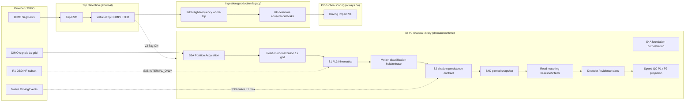

# System Architecture — Driving Intelligence V0 Shadow Path & Production Legacy

**Status:** VERIFIED against `origin/main` @ `0a16ffb5b` (code paths); production activation **REPORTED** via `CURRENT_STATE.md` / deployment evidence.

## Executive boundary

| Owns | Does not own |
|------|----------------|
| Post-trip enrichment, stress scoring, V2 stage DAG (flag-gated) | Canonical trip boundaries (DIMO Segments + Trip FSM) |
| DI V0 shadow kinematics (library) | Live trip motion FSM decisions |
| S4 shadow / research road matching (mostly dormant) | Mapbox route matching as trip geometry authority |
| Speed QC / trip speed quality projection (opt-in paths) | Raw DIMO OAuth (shared telemetry layer) |

## End-to-end pipeline (research + shadow intent)

Solid arrows: **VERIFIED** production or implemented library data flow. Dotted: **flag-gated, dormant, or research-only** on `main` @ dossier base SHA.

## Component reference

### DIMO / Provider

| Field | Detail |
|-------|--------|
| **Purpose** | Telemetry source for coordinates, HF behavior, segments |
| **I/O** | GraphQL `signals(interval:"1s")`; segment APIs for trip windows |
| **Code** | `dimo-segments.service.ts`, shared telemetry transport |
| **Time contract** | Bucket labels calendar 1s; **providerTimestamp ≠ wall-clock truth** (RD003/RD004) |
| **Production** | **VERIFIED** — legacy HF fetch active |
| **Research** | S3A query: coordinates only (`EXP021_C1D7`) |

### Ingestion (production legacy)

| Field | Detail |
|-------|--------|
| **Purpose** | Behavior events + counters after trip complete |
| **I/O** | `VehicleTrip` window → HF points → `TripBehaviorEvent` |
| **Code** | `trip-behavior-enrichment.processor.ts`, `hf-*.ts` |
| **Limits** | ~1 Hz assumption in comments; RD002/RD003 prove variable spacing |
| **Production** | **VERIFIED** active |
| **Research** | Recovery V2 / block polling code deployed, feature **OFF** |

### S3A Position Acquisition

| Field | Detail |
|-------|--------|
| **Purpose** | Strict 1s grid DIMO coordinates for DI V0 |
| **I/O** | `[from,to)` buckets → PRESENT / SIGNAL_NULL / ROW_ABSENT |
| **Code** | `driving-intelligence/position-acquisition/` |
| **Dependencies** | DIMO auth adapter; **no speed in query** |
| **Production** | **NONE** — no runtime caller (PR #1800) |
| **Research** | **VERIFIED** library + tests |

### Position normalization

| Field | Detail |
|-------|--------|
| **Purpose** | `DI_NORMALIZED_INPUT_IDENTITY` SHA-256 for replay |
| **Code** | S3A + shadow S2 `inputEvidenceVersion` |
| **Limits** | Provider historical mutability observed (C1G) — live re-query ≠ replay |

### S1 / L3 Kinematics

| Field | Detail |
|-------|--------|
| **Purpose** | Centred-path speed estimate + motion states |
| **I/O** | Classified position rows → `evaluateL3AtCenter` → km/h or withheld |
| **Code** | `core/kinematics/l3-eligibility.ts`, `compute-trip-intervals.ts` |
| **Algorithm** | Haversine mean over calendar **t−1, t, t+1** when all FRESH; `L3_CENTERED_PATH` |
| **Dependencies** | S3A positions; **t+1 lookahead** for batch replay |
| **Limits** | Hold/release/stationary band; not identical to online causal mask without policy |
| **Production** | Shadow library only on main |
| **Research** | Golden tests FULL-R1-002; video tacho MAE **REPORTED** (see L3 doc) |

### Motion classification / Hold–Release

| Field | Detail |
|-------|--------|
| **Purpose** | Abstain numeric speed during transitions; stationary band |
| **Code** | S1 motion states in `compute-trip-intervals.ts` |
| **Separate from** | **Trip FSM** (trip lifecycle), **CUSUM** (if used elsewhere in trip detection — not DI V0 core), **Micro-motion FSM** (EXP021 B7.1 design — **NOT_IN_REPO** product code) |

### S4 Shadow runtime

| Field | Detail |
|-------|--------|
| **Purpose** | Pinned evidence bundles, work items, PRIMARY shadow completion |
| **Code** | `s4a-foundation/`, S4B orchestration (dormant registration), production shadow paths per EXP021 S4P* evidence |
| **Production** | **REPORTED** — schema/migrations may exist; global kill / tiny staging per S4F7* series; **not** full fleet road-matching activation |
| **Research** | S4 research worker PR C on main (flags default OFF) |

### Road matching

| Field | Detail |
|-------|--------|
| **Purpose** | Associate GPS buckets with OSM ways |
| **Code** | Production shadow pipeline + `s4-research/` pure library |
| **Output** | `ASSOCIATED` = algorithmic only; `independentRoadIdAccuracy: NOT_ASSESSABLE` |
| **See** | [ROAD_MATCHING_EVOLUTION.md](./ROAD_MATCHING_EVOLUTION.md) |

### Decoder / Quality / Projection

| Field | Detail |
|-------|--------|
| **Speed QC P1** | `speed-qc/evaluate-di-v0-speed-qc-interval.ts` — V1 default, V2 opt-in (#2021) |
| **P2 projection** | Trip speed quality tables; auto path dormant (#2028) |
| **Production read** | V2 product read path evidence `EXP021_V2_PRODUCT_READ_PATH.md` |

### Later product integration

| Surface | Data |
|---------|------|
| `vehicle-intelligence.controller.ts` | Trips, impact, events |
| V2 Grafana / Master Admin S4 (#1990) | Ops visibility |
| Health publish | Tire/brake load **proxies** |

## Trip FSM vs CUSUM vs Micro-motion (mandatory separation)

| System | Owner module | Role in stop/go story |
|--------|--------------|------------------------|
| **Trip FSM** | Trip Detection / `TripDecisionEngine` | When a **trip** starts/ends/rests; COMPLETED triggers DI |
| **CUSUM / segment detectors** | Trip detection stack (outside DI V0 core) | May influence segment boundaries — **NOT** DI shadow stop semantics |
| **DI S1 hold/release + stationary band** | `driving-intelligence/core` | Per-second kinematic abstention |
| **Micro-motion FSM (B7.1)** | Design artifact only | Threshold+hysteresis for short stops — **HYPOTHESIS** for research |

Confusing Trip FSM `RESTING` with DI `STATIONARY_SUPPORTED` is a documented failure mode ([FAILURE_MODE_CATALOG.md](./FAILURE_MODE_CATALOG.md)).
