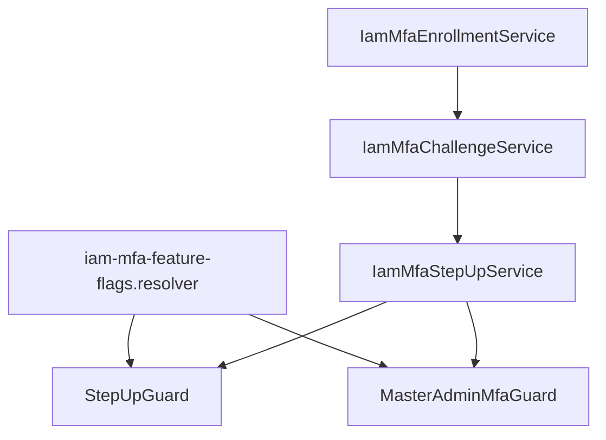

# IAM MFA — Knowledge Graph Overview

Machine-readable graph: `graph/*.yaml`. Validate with `scripts/validate-graph.sh`.

## Runtime flow (repository)

## Decision register (summary)

| ID | Title | Status |
|----|-------|--------|
| IAM-MFA-DEC-FLAGS-001 | Default-off MFA rollout | VALIDATED |

Full record: [`decisions/DECISION_REGISTER.md`](decisions/DECISION_REGISTER.md).

## Open gaps

| ID | Gap |
|----|-----|
| IAM-MFA-GAP-001 | Production IAM MFA flag attestation |
| IAM-MFA-GAP-002 | WebAuthn enrollment path |

## Contradictions

| ID | Topic |
|----|-------|
| IAM-MFA-CX-001 | Merged implementation vs unknown Production activation |

## Historical documentation (supporting)

- [`architecture/IAM_MFA_STEP_UP_2026-07-21.md`](../IAM_MFA_STEP_UP_2026-07-21.md) — preserved; not sole authority