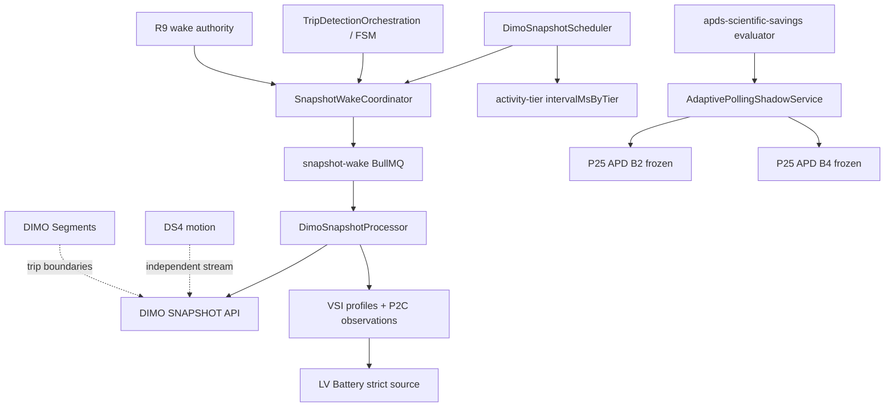

# APDS V3 P1B0 — Consumer demand and offline policy engine

**Status:** `DRAFT_OFFLINE_ONLY` — not production-active.  
**Ancestor:** P1A `9977bdddb91707d9c682ab0931179dcbfae4fb43`  
**Registry:** `APDS_V3_CONSUMER_DEMAND_V1`, evaluator `APDS_V3_OFFLINE_P1B0`

## ARCHITECTURE_DEPENDENCY_MAP (verified)

**Physical SNAPSHOT consumers (grounded):** LV battery strict path, trip FSM orchestration / wake, reconciliation snapshot path, VSI P2C top-level provider source observations (soft).  
**Non-SNAPSHOT or parallel channels:** DIMO Segments trips, DS4 motion (listed `NOT_APPLICABLE` for skip calculus), historical signal fetches inside VSI.

## CONSUMER_DEMAND_CONTRACT

Versioned read-only registry: `backend/.../consumer-demand-registry.v1.ts`.  
Unknown freshness remains `UNKNOWN`. Timestamp classes: provider source, observed-at, fetched-at, processing — separated in evaluator inputs (`lastLvProviderSourceMs`, `lastProviderFetchedAtMs`, `decisionAtMs`).

## VSI_INFORMATION_GAIN_MODEL

`vsi-information-gain.v1.ts` — heuristic expected gain in `[0,1]`, labeled `heuristic: true`. Contradictory or unknown observation quality → fail-closed upstream (`INSUFFICIENT_EVIDENCE` / DO_NOT_SKIP path).

## V3_OFFLINE_POLICY

`apds-v3-offline-policy.evaluator.ts` — decisions: `WOULD_POLL`, `WOULD_SKIP`, `FORCED_SAFETY_POLL`, `INSUFFICIENT_EVIDENCE`, `NOT_ASSESSABLE`. No enqueue, no flag changes. Frozen B2/B4 files untouched; offline uses `evaluateP25ApdB2V1Core` / `B4V1Core` intersection for conservative backbone.

## REPLAY_HARNESS

`apds-v3-p1b0-replay-core.ts` + `backend/scripts/ops/apds-v3-p1b0-replay-harness.ts` — separates decision ticks, canonical eligibility, deduped physical requests, hypothetical research candidates, and counterfactual skip metrics. **Not realized savings.** `KS_MX_2024` excluded from savings calibration. LV miss metrics require `lvStrictSourceAdvanceObservedAtMs` evidence.

## Consumer demand research boundary

Certified `WOULD_SKIP` is blocked when hard-safety consumers have UNKNOWN freshness (registry v1). `HYPOTHETICAL_RESEARCH_CANDIDATE_SKIP` replay class is observational only.

## Scientific limitations

See `architecture/vehicle-device-connectivity/APDS_V3_P1B0_SCIENTIFIC_LIMITATIONS.md`.

## Governance

- No second scheduler.  
- No production activation.  
- `FINAL_GO_NO_GO=P1B0_OFFLINE_ONLY`
