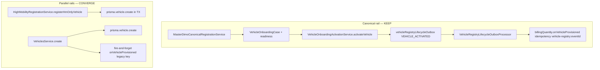

# V2B — Canonical Registration Convergence Plan

**Operation:** `SYNQDRIVE_VEHICLES_V2B_CANONICAL_REGISTRATION_CONVERGENCE_PLAN`  
**Base:** `origin/main` @ `ff962e50acdf75219e36bf8ba62e364c0165df5f`  
**Prerequisite evidence:** [V2A_REGISTRATION_BILLING_SAFETY_2026-11-22.md](./V2A_REGISTRATION_BILLING_SAFETY_2026-11-22.md) (draft PR #2497)  
**Mode:** Implementation design and contract — **no** runtime cutover, **no** flag activation, **no** live provider mutations.  
**Normative reconciliation:** V2B-PR6 closeout @ `VO-DEC-2B-003` — see **§1B** for current architecture; §2–§4 and §7 retain **historical** pre-PR4 design text.

## 1. Purpose

Define a **minimal, reversible** path to converge **all vehicle registration entrypoints** onto the existing **Vehicle Onboarding activation rail** (`VehicleOnboardingActivationService.activateVehicle`) while:

- Preserving **Master DIMO canonical registration** (`MasterDimoCanonicalRegistrationService`) unchanged in semantics.
- Preserving **`Vehicle.id`** as the durable identity; no identity migration.
- Preserving tenant isolation, provider links, offboarding guards, billing history, Master Admin UX, entitlements.
- Enforcing **durable `VEHICLE_ACTIVATED` registry outbox + single billing consumer** per activation.
- **Prohibiting** automatic retroactive billing for legacy vehicles.

**Target policy (proposed — owner approval required):**

| # | Policy |
|---|--------|
| 1 | DIMO continues canonical activation (case → readiness → activation TX → outbox). |
| 2 | HM_ONLY converges to the same activation/outbox rail (no parallel inline `vehicle.create` long term). |
| 3 | **SUPERSEDED (V2B-PR4):** Manual fleet vehicle creation **retired** — new vehicles only via DIMO or High Mobility. |
| 4 | Every **new** activation emits exactly one durable `VEHICLE_ACTIVATED` outbox row per onboarding case. |
| 5 | Billing quantity effects only via `VehicleRegistryLifecycleOutboxProcessor` (no duplicate legacy hook). |
| 6 | **No** batch backfill of outbox/billing for pre-V2B vehicles without explicit owner migration program. |

## 1B. Normative architecture (current — post V2B-PR4 / PR5 / PR6)

**Authoritative as of main @ V2B-PR6; supersedes normative claims in §2–§4 where they conflict.**

| Topic | Current normative truth | Evidence |
|-------|-------------------------|----------|
| New vehicle registration | **DIMO or High Mobility only**; manual HTTP/UI **retired** | VO-DEC-2B-002, V2B-PR4 |
| Registration billing | **Single consumer:** `VehicleRegistryLifecycleOutboxProcessor` → `onVehicleProvisioned` on `VEHICLE_ACTIVATED` | VO-DEC-2B-003, PG-05, V2B-PR6 |
| Legacy `VehiclesService.create` billing hook | **Removed** — `create` fail-closes with `MANUAL_VEHICLE_REGISTRATION_RETIRED` | V2B-PR4 |
| `VEHICLE_REGISTRATION_CONVERGENCE_BILLING_SINGLE_RAIL` | **NOT_ARMABLE**; **not required** to enforce registration billing authority | V2B-PR6 |
| HM_ONLY canonical | Behind `VEHICLE_REGISTRATION_HM_ONLY_CANONICAL_ENABLED` (default OFF) | V2B-PR2/PR3 |
| HM_ONLY legacy (flag OFF) | Inline vehicle row; **no** outbox/billing (gap preserved) | PG-05-C |
| Integration harness | `createVehicleRowForIntegrationHarness` — **not** a registration channel; production **default deny** with **explicit** `ALLOW_VEHICLE_ROW_INTEGRATION_HARNESS=1` override | V2B-PR4/PR6 |
| Manual canonical (M-A/B/C) | **Not implemented** — options in §3.3 are historical | OWN-1 SUPERSEDED |
| Rollback to manual create + legacy hook | **Not applicable** for new registrations | OWN-2 NOT_APPLICABLE |

**PR6 / PR10 transition (reconciled):** PR6 certifies existing single authority; PR10 is optional **inert-helper cleanup** after OWN-5 — not a registration billing cutover.

## 2. Current-state architecture (verified) — HISTORICAL (pre-V2B-PR4 baseline)



| Path | Registry outbox | Billing trigger | Connection identity in TX |
|------|-----------------|-----------------|---------------------------|
| DIMO canonical | Yes (`activationOutboxIdempotencyKey(caseId)`) | Outbox processor | Yes (VO-SIG assertions) |
| HM_ONLY | **No** | **None** | Partial (VDSL only, no VO activation) |
| Manual create | **No** | Legacy hook (`vehicle:connected:org:vehicleId`) | **No** |

**Billing note:** `onVehicleProvisioned` only records a license when the vehicle is **billable per** `BillableVehiclesService` / product policy. Non-connected manual vehicles may remain **non-billable** while still being **registry-active** — owner must confirm this matches commercial intent for policy #3.

## 3. Target architecture contract

### 3.1 Shared convergence port (new)

Introduce an internal **registration convergence port** (Core / Vehicle Onboarding owned):

```typescript
// Contract sketch — not implemented in V2B plan PR
interface VehicleRegistrationConvergencePort {
  /**
   * Idempotent under stable external idempotencyKey per org+path.
   * Must not create second Vehicle.id for same provider claim.
   */
  registerHmOnlyCanonical(input: HmOnlyConvergenceInput): Promise<ConvergenceResult>;
  registerManualCanonical(input: ManualConvergenceInput): Promise<ConvergenceResult>;
}
```

**Invariants (all paths):**

1. **Tenant:** `organizationId` on case, vehicle, outbox, billing must match authenticated tenant (master admin explicit org only).
2. **Vehicle identity:** Same `vehicle.id` on retry; VIN uniqueness per org enforced in activation TX (not only pre-check).
3. **Provider binding:** Existing `vehicleDataSourceLink` / connection-identity metadata rules; HM uses `appendHmCanonicalRegistrationHistoryIfNeeded` on canonical path.
4. **Registry lifecycle:** `registryLifecycle = ACTIVE` set in activation TX (same as VO-3).
5. **Outbox:** Exactly one semantic `VEHICLE_ACTIVATED` per `onboardingCaseId` (`vehicle-onboarding:VEHICLE_ACTIVATED:v1:{caseId}`).
6. **Billing:** Processor supplies `buildRegistryActivateBillingIdempotencyKey(eventId)`; **legacy hook suppressed** when convergence flag armed for that path.
7. **Offboarding:** `OFFBOARDED` / `ARCHIVED` vehicles and orgs rejected at readiness + `vehicle-registry-admission` (existing); convergence must call same guards.
8. **No retroactive billing:** New outbox `occurredAt = activation time`; processor may pass `retroactiveAuthorized` only for **outbox event-time** (existing VO5B behavior), not for historical backfill jobs.

### 3.2 HM_ONLY convergence design

**Recommended approach:** **Orchestrate through existing onboarding primitives** (not “outbox-only patch”):

1. `VehicleOnboardingCaseService.openOrResumeHighMobility` (or adopt HM source on existing case) with HM mirror snapshot.
2. Run readiness for org product profile (HM_ONLY / HIGH_MOBILITY source mode).
3. `VehicleOnboardingActivationService.activateVehicle` with HM consent + connection identity assertions in TX.
4. Deprecate inline `tx.vehicle.create` in `HighMobilityRegistrationService` behind flag **after** PG parity.

**Readiness parity gaps to close in implementation:**

| Area | Current HM_ONLY | Canonical requirement |
|------|-----------------|------------------------|
| Readiness snapshot | Skipped | `VehicleOnboardingReadinessService` PASS for selected product |
| Connection identity | VDSL only | `assertTelemetryConnectionIdentityForActivationTx` / HM contract |
| Source set invariant | N/A | ≤1 HM, ≤1 DIMO per `assertSupportedActivationSourceSet` |
| Technical baseline | Minimal scalars | `materializeTechnicalBaselineInActivationTx` or documented MANUAL/HM waiver for HM_ONLY profile |
| Provider unavailable | HM record local | Fail closed if HM mirror stale; **no live HM API** in registration TX (existing rule) |

**Concurrency:** Use existing advisory locks (`vehicle-onboarding-activation:{caseId}`) + HM registration state `REGISTERED` conflict.

**Failure / recovery:** Idempotent resume via `tryResumeMasterDimoRegistration` pattern — add **HM_ONLY resume** keyed by `hmVehicleId` + org.

### 3.3 Manual create convergence design — HISTORICAL (manual channel retired VO-DEC-2B-002)

**Preserve UX:** Keep `POST /vehicles` (or equivalent) for org operators.

**Implementation choices (owner pick one):**

| Option | Description | Pros | Cons |
|--------|-------------|------|------|
| **M-A (recommended)** | HTTP handler calls `openOrResumeManual` → capture admin baseline → readiness → `activateVehicle` | Full parity, tests reuse VO-3 PG harness | Slightly higher latency; requires idempotency key from client or server fingerprint |
| **M-B** | Keep `VehiclesService.create` but delegate to convergence port post-create | Smaller API diff | Risk of double vehicle row if TX boundaries wrong |
| **M-C** | Master-only manual via onboarding API; restrict tenant create | Strongest guard | Conflicts with policy #3 unless rental keeps separate path |

**No-provider / no telemetry:** `sourceMode: MANUAL`, `provider: MANUAL` — readiness profile must allow **missing DIMO/HM** (existing `MANUAL` rules in `readiness-rule-engine.ts`). Connectivity `DISCONNECTED` is valid; billing may still skip per billable policy (owner confirm).

### 3.4 Single billing rail — HISTORICAL (superseded by VO-DEC-2B-003; no production create hook remains)

**Phase-out contract for `VehiclesService.create` hook:**

| Phase | Behavior |
|-------|----------|
| T0 (today) | Legacy hook active |
| T1 | Convergence writes outbox; hook **no-op when** `VEHICLE_REGISTRATION_CONVERGENCE_BILLING_SINGLE_RAIL=1` **and** vehicle has published `VEHICLE_ACTIVATED` for case |
| T2 | Hook removed (code delete) after one release with T1 default-on |

**Duplicate prevention:**

- Never call legacy hook in same request as successful activation outbox insert.
- PG test: single quantity ledger row per vehicle activation event id.
- If legacy row already exists for vehicle, convergence **must not** second-charge — migration script **opt-in only** (owner), not V2B auto.

### 3.5 Legacy vehicle compatibility

| Cohort | Registry outbox | Billing | V2B action |
|--------|-----------------|---------|------------|
| Pre-V2B DIMO canonical | Yes (if registered via VO-SIG P2) | Via outbox | **No change** |
| Pre-V2B HM_ONLY inline | No | Missing or inconsistent | **Remain as-is** until owner migration; optional manual “registry repair” job **flagged off** |
| Pre-V2B manual create | No | May have legacy hook event | **No retroactive outbox** |
| New registrations post-cutover | Required | Outbox only | Enforced by convergence flags |

## 4. Feature flags and rollback (proposed env names)

All default **`false`** in code and `.env.example` until owner arms per environment.

| Flag | Scope |
|------|--------|
| `VEHICLE_REGISTRATION_HM_ONLY_CANONICAL_ENABLED` | Route HM_ONLY through convergence port |
| `VEHICLE_REGISTRATION_MANUAL_CANONICAL_ENABLED` | **SUPERSEDED (VO-DEC-2B-002)** — do not arm; manual create removed |
| `VEHICLE_REGISTRATION_CONVERGENCE_BILLING_SINGLE_RAIL` | Suppress `VehiclesService.create` billing hook |
| `VEHICLE_REGISTRATION_CONVERGENCE_SHADOW_COMPARE` | Run canonical path in shadow log-only alongside legacy (HM/manual) — **no user-visible duplication** |

**Rollback (historical note):** Pre-PR4, disabling flags reverted legacy HM/manual paths. **Current:** manual create is **retired**; rollback does **not** restore manual registration or a production create billing hook (OWN-1/OWN-2).

## 5. Security gates (must pass before each cutover flag)

- Cross-org registration rejection (tenant + master admin body org).
- Duplicate VIN within org (`ConflictException` / `VIN_CONFLICT_REQUIRES_IDENTITY_REVIEW`).
- Duplicate provider claim (HM id / DIMO id already linked).
- `OFFBOARDED` / `ARCHIVED` org and vehicle registry lifecycle.
- Unauthorized roles (existing `fleet.write` / product guards).
- Billing idempotency under concurrent activation (PG race specs).
- Provider unavailable → fail closed (no orphan vehicle without compensating rollback).

## 6. PostgreSQL test matrix (disposable)

| ID | Suite / new spec | Env gate | Assertions |
|----|------------------|----------|------------|
| PG-01 | `vo-sig-p2-master-dimo-registration.postgres` | `VO_SIG_P2_MASTER_DIMO_PG=1` | Baseline regression — single outbox, idempotent retry |
| PG-02 | `vo5b-ab1-registry-billing-activate.postgres` | existing | Billing idempotency key on ACTIVATED |
| PG-03 | **NEW** `v2b-hm-only-canonical-convergence.postgres` | `V2B_HM_ONLY_CANONICAL_PG=1` | HM_ONLY → case → activate → 1 outbox → 1 billing event |
| PG-04 | ~~`v2b-manual-canonical-convergence.postgres`~~ | — | **CANCELLED** — manual registration retired (V2B-PR4); use HTTP 409 retirement specs |
| PG-05 | `v2b-provider-billing-outbox-parity.postgres` | `V2B_PROVIDER_BILLING_PARITY_PG=1` | DIMO/HM canonical outbox+billing parity; HM legacy flag-OFF baseline; **V2B-PR6** certifies single registration billing authority |
| PG-06 | `vo4-activation-races.postgres` | existing | Concurrent activate same case |
| PG-07 | `vo5a-offboarding` + org ARCHIVED | org offboarding PG gates | Reject registration |
| PG-08 | `high-mobility-vehicle-register.http-security` | unit/HTTP | Tenant OFFBOARDED policy |
| PG-09 | **NEW** partial TX failure replay | `V2B_ACTIVATION_FAILURE_REPLAY_PG=1` | Rollback + safe retry |
| PG-10 | Multi-org isolation | reuse VO3 harness | Org A cannot adopt Org B HM/DIMO |

CI: wire PG-03–05 into VO PostgreSQL workflow when files land (same pattern as VO5B gate).

## 7. Transaction boundaries

| Step | Transaction | On failure |
|------|-------------|------------|
| Case open/adopt | Own TX or nested | No vehicle row |
| Readiness mutation | Advisory lock per case | Retry safe |
| **Activation** | **Single TX:** vehicle, links, registry lifecycle, outbox insert, consent/baseline | Full rollback; case not COMPLETED |
| Outbox process | Separate worker TX | Retry with outbox status; idempotent billing |
| Legacy hook (pre-T2) | Post-commit async | **HISTORICAL** — public create hook removed V2B-PR4; PR10 optional inert-helper cleanup |

HM_ONLY **must not** commit vehicle row outside activation TX once converged.

## 8. PR sequence (small slices)

| PR | Title | Runtime change | Flag |
|----|-------|----------------|------|
| **#2497** | V2A characterization (prerequisite) | Tests/docs only | — |
| **V2B-PR1** | Convergence port + flags (wired default off) | No behavior | off |
| **V2B-PR2** | HM_ONLY canonical implementation + unit tests | Behind `HM_ONLY_CANONICAL` | off |
| **V2B-PR3** | HM_ONLY PG harness PG-03 + security regressions | Tests | — |
| **V2B-PR4** | **Manual registration removal** — DIMO/HM-only channel restriction | HTTP/UI lockdown; no flag arm | — |
| **V2B-PR5** | Provider-only billing/outbox parity + registration admission tests | Tests | — |
| **V2B-PR6** | Single registration billing authority (reconciled post-PR4) | Evidence + characterization; **no** new armable transition | — |
| **V2B-PR7** | HM readiness observation (legacy vs canonical; bounded metrics) — **no billing shadow** | `VEHICLE_REGISTRATION_CONVERGENCE_SHADOW_COMPARE` | off |
| **V2B-PR8** | Docs + authority + decision register | Docs | — |
| **V2B-PR9A** | Production readiness + inventory | Ops/docs | owner-gated |
| **V2B-PR9B** | Owner release authorization | Ops attestation | owner-only |
| **V2B-PR9C** | Direct production cutover + smoke | **Production** ops | owner-only |
| **V2B-PR10** | Remove inert legacy helpers + harness cleanup (post OWN-5) | Delete dead routing / optional harness tighten | owner-only |

**No merge to production flags** in V2B-PR1–8 without owner instruction.

## 9. Owner policy approvals required

| ID | Decision |
|----|----------|
| OWN-1 | **SUPERSEDED_BY_OWNER_DECISION** — manual create removed; option M-A not implemented. |
| OWN-2 | **NOT_APPLICABLE_AFTER_REMOVAL** — new manual vehicles cannot be created. |
| OWN-3 | **OWNER_APPROVED** (OWN-3-A) — [attestation](./V2B_PR8_OWNER_ATTESTATION_2026-11-24.md) @ 2026-11-24. |
| OWN-4 | **OWNER_APPROVED** (OWN-4-A) — no retroactive registration billing. |
| OWN-5 (shadow) | **SUPERSEDED** — historical attestation only. |
| OWN-5B | **OWNER_APPROVED** — direct production cutover; **PR9A–C**; no shadow soak. |
| OWN-6 | **OWNER_APPROVED** (OWN-6-A) — inventory policy only; production execution not authorized by attestation. |

## 10. Risks and mitigations

| Risk | Impact | Mitigation |
|------|--------|------------|
| Double billing during transition | Revenue / trust | Single-rail flag + PG-05; suppress hook when outbox exists |
| HM readiness stricter than legacy | Blocked registrations | Product-specific readiness profile; shadow compare PR7 |
| Latency on manual create | UX | Async outbox processing unchanged; optimize case open path |
| Partial activation failure | Orphan case | VO-3 rollback tests + replay idempotency |
| Legacy fleet inconsistency | Reporting | Document cohort table; no auto backfill |
| Billable policy skips manual vehicles | Missing revenue | Owner decision OWN-2 |

## 11. Acceptance criteria (V2B complete)

1. With HM canonical flag **on** in disposable PG: HM_ONLY and DIMO each produce **exactly one** `VEHICLE_ACTIVATED` and **at most one** billing quantity add per activation. **Manual registration excluded** (retired).
2. **No** reachable production registration path invokes a parallel legacy create `onVehicleProvisioned` hook (**VO-DEC-2B-003**). `BILLING_SINGLE_RAIL` arming is **not** a registration prerequisite.
3. Cross-org, duplicate VIN, duplicate provider, OFFBOARDED/ARCHIVED, and provider-unavailable cases **fail closed** with existing error contracts.
4. DIMO `MasterDimoCanonicalRegistrationService` diff is **delegation-only** to convergence (no semantic change to P2 flow).
5. Flags **off** restore pre-V2B behavior (rollback verified in CI).
6. Owner attestation record for production flag arm (separate from merge).

## 12. Lifecycle status

| Stage | Status |
|-------|--------|
| Design contract (this document) | **PROPOSED** (§1B normative for post-PR4 facts) |
| Implementation | **IN PROGRESS** (V2B-PR1–PR7 **merged** @ `ff90ff14`; V2B-PR8 owner package **DRAFT**; cutover flags not armed) |
| Cutover | **FORBIDDEN** until owner approval |
| Production validation | **NOT CLAIMED** |