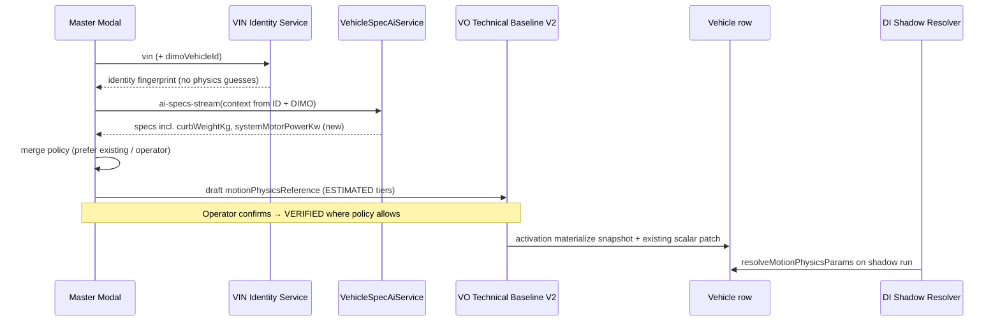

# Vehicle Physics Phase 2 — Implementation Plan (binding)

**Status:** Design / implementation-ready  
**Date:** 2026-10-24  
**Scope:** Motion-event vehicle envelope (P2 shadow) fed from **one** stammdaten path: Master registration → VIN identity → Mistral AI-Spec enrichment → operator confirmation → Technical Baseline V2 → `Vehicle` materialization → `resolveMotionPhysicsParams` for DI shadow only.

**Predecessors:** Phase 1 read-only audit (fleet `Vehicle` + VO baseline); Phase 1B contract (`motionPhysicsReference`, fail-closed resolver, optional post–Universal-P2 pass). Production motion hardening: Universal `MOTION_EVENT_PLAUSIBILITY_UNIVERSAL_V0_2` + P1 spike bracket (no per-vehicle inputs).

---

## 1. Binding product rules (non-negotiable)

| Rule | Implementation implication |
|------|---------------------------|
| Preserve full Master onboarding + Mistral AI-Spec flow | Extend existing endpoints, schema, modal, and `extraData` → VO mappers — **no** parallel “motion profile” UI or API. |
| Motion physics via **same** automated enrichment | `systemMotorPowerKw`, mass, optional envelope limits are **candidates** in AI-Spec + baseline draft; not a separate form-first system. |
| VIN decode ≠ free AI | Structured **identity** (make/model/year/variant/trim where available) must come from VIN/DIMO/HM/manufacturer decode **before** Mistral fills **spec** gaps. Mistral must not invent VIN structure. |
| Prefer existing values | Merge policy: `Vehicle` scalars, confirmed baseline, operator edits beat AI stream fills. |
| Provenance per field | Source, variant binding, confidence, evidence tier on every motion field. |
| Mistral without proof → **ESTIMATED** | Default evidence tier for AI-Spec outputs; **VERIFIED** only with documented source + operator confirmation workflow (mirror HV/battery reference patterns). |
| Operator approval in Master/VO UI | Reuse `VehicleRegistrationModal` + VO technical baseline review; show AI vs existing vs decode. |
| Materialize via Technical Baseline V2 | `motionPhysicsReference` section in draft; activation TX writes durable vehicle snapshot. |
| Backfill legacy vehicles | Same path: re-run enrichment + optional operator confirm + baseline patch (no one-off columns-only hack). |
| Missing / unconfirmed → Universal P2 only | `resolveMotionPhysicsParams` returns `vehicleEnvelopeApplicable: false`; shadow pass is identity. |
| **No** changes to C4, C5.1, FSM, event-detector thresholds | Vehicle envelope is **additive** shadow-only until explicitly promoted later. |
| **No** second vehicle profile system | Single contract on baseline + materialized snapshot; DI reads resolver only. |

---

## 2. Current architecture (code anchors)

### 2.1 Master registration + AI-Spec (keep)

| Layer | Location | Today |
|-------|----------|--------|
| AI-Spec HTTP | `backend/src/modules/ai/vehicle-specs/vehicle-specs.controller.ts` | `GET /vehicles/register/ai-specs`, `ai-specs-stream`; resolves context via query + `dimoVehicle` Prisma lookup (`vin`, `make`, `model`, `year`, `tokenId`). |
| Mistral schema | `vehicle-spec-ai.schema.util.ts` | `VEHICLE_SPEC_FIELD_KEYS` includes `curbWeightKg`, `drivetrain`, `frontToRearWeightDistribution`, brakes, HV, **no** `systemMotorPowerKw` or accel/brake envelope limits. |
| Master UI | `frontend/src/master/components/VehicleRegistrationModal.tsx` | Streams AI into form fields (e.g. curb weight). |
| Master → VO | `frontend/src/master/connected-vehicles/master-vehicle-registration.ts` | `buildVehicleExtraData` → `curbWeightKg`, drivetrain, intervals, HV capacities. |
| Activation patch | `master-dimo-registration.mapper.ts` | `buildPostActivationVehiclePatch` materializes scalars (`curbWeightKg`, `frontWeightDistributionPct`, …) onto `Vehicle`. |
| Technical baseline V2 | `vehicle-technical-baseline-draft.v2.ts` | Brakes, tires, HV reference — **no** motion physics block. |
| Materialization | `technical-baseline-materialization.ts` | Brakes + HV on activation; curb weight already on `Vehicle` via Master patch. |

### 2.2 Driving Intelligence (unchanged detectors; new read path only)

| Layer | Location | Today |
|-------|----------|--------|
| Universal P2 | `motion-event-physics-envelope.ts` | `MOTION_EVENT_PLAUSIBILITY_UNIVERSAL_V0_2` — no vehicle inputs. |
| Shadow worker | `di-v0-motion-core-shadow-processor.ts` | Applies Universal P2 after detection. |
| Vehicle envelope | *not implemented* | Phase 2 adds resolver + optional `applyMotionEventVehiclePlausibility` **after** Universal P2. |

### 2.3 VIN identity (gap to close in Phase 2)

Repository audit (2026-10-24): **no** dedicated backend VIN-decode service (no VPIC/NHTSA module). Identity today:

- DIMO `dimoVehicle` mirror (`vin`, `make`, `model`, `year`),
- Manual VIN in Master modal,
- High Mobility availability check (health clearance, not full spec decode).

**Plan requirement:** Introduce a **structured VIN identity step** in the enrichment pipeline (provider TBD: EU OEM/WMI registry, paid decode API, or HM/DIMO-supplied variant fields when present). This step produces **identity facts** only; numeric physics specs still flow from confirmed specs + Mistral **enrichment**, not from “guess the VIN”.

Provenance source enum should align with battery reference vocabulary where possible (`VIN_DECODED_VERIFIED`, `MANUFACTURER_VERIFIED`, `VERIFIED_VEHICLE_SPEC`, `MANUAL_VERIFIED`, plus `MISTRAL_AI_ESTIMATED` for AI-only estimates).

---

## 3. Target data contract — `motionPhysicsReference` (Technical Baseline V2 + snapshot)

### 3.1 Draft section (VO)

Add to `VehicleTechnicalBaselineDraftV2`:

```ts
interface MotionPhysicsFieldProvenance {
  source: MotionPhysicsSource; // see enum below
  confidence: number; // 0..1
  variantBinding?: string | null; // e.g. trim / motor code / AI variant label
  retrievedAt?: string | null; // ISO
  documentId?: string | null;
  operatorConfirmedAt?: string | null;
  operatorConfirmedBy?: string | null;
  notes?: string | null;
}

interface MotionPhysicsScalarField {
  value: number;
  unit: 'kg' | 'kW' | 'mps2';
  evidenceStatus: 'ESTIMATED' | 'VERIFIED';
  provenance: MotionPhysicsFieldProvenance;
}

interface VehicleOnboardingMotionPhysicsReferenceDraft {
  contractVersion: 'motion-physics-ref-v1';
  curbMassKg?: MotionPhysicsScalarField | null;
  systemMotorPowerKw?: MotionPhysicsScalarField | null;
  /** Optional OEM-style longitudinal limits for shadow envelope only */
  maxLongitudinalAccelMps2?: MotionPhysicsScalarField | null;
  maxLongitudinalDecelMps2?: MotionPhysicsScalarField | null;
  /** WMI/VIN decode identity used for this draft (audit) */
  identityFingerprint?: {
    vin?: string | null;
    make?: string | null;
    model?: string | null;
    modelYear?: number | null;
    variantLabel?: string | null;
    decodeProvider?: string | null;
    decodedAt?: string | null;
  } | null;
}
```

### 3.2 Materialized snapshot on `Vehicle`

- **Preferred:** Prisma JSON column `motionPhysicsSnapshotJson` (versioned blob mirroring approved draft fields + `materializedAt`, `baselineCaseId`).
- **Resolver inputs (priority):** snapshot JSON → legacy `Vehicle.curbWeightKg` / `frontWeightDistributionPct` (mass only, with degraded provenance) → none.

Do **not** add ad-hoc `systemMotorPowerKw` on `Vehicle` unless product explicitly requires SQL reporting; keep physics bundle in snapshot for auditability.

### 3.3 `resolveMotionPhysicsParams(vehicleId)` (DI)

Returns:

```ts
{
  contractVersion: 'motion-physics-resolve-v1';
  vehicleEnvelopeApplicable: boolean; // true only if VERIFIED curb mass AND (VERIFIED envelope OR VERIFIED system power for derived envelope)
  curbMassKg: number | null;
  systemMotorPowerKw: number | null;
  maxLongitudinalAccelMps2: number | null;
  maxLongitudinalDecelMps2: number | null;
  resolutionNotes: string[];
}
```

**Fail-closed:** if `vehicleEnvelopeApplicable === false`, vehicle shadow pass is a no-op (events identical to Universal+P1).

**Derived envelope (optional):** When only `systemMotorPowerKw` + VERIFIED mass are present, allow conservative derivation of accel cap (document formula + safety margin in implementation); never derive mass from power.

---

## 4. Enrichment pipeline (single path)



### 4.1 Step A — VIN identity (new backend module, thin)

- Input: `organizationId`, `vin`, optional `dimoVehicleId`.
- Output: `VehicleIdentityFingerprint` (make/model/year/variant fields + `decodeProvider` + raw decode reference stored for audit, not shown to Mistral as license to invent numbers).
- **Hard rule:** If decode fails, still allow Mistral **only** with explicit `knowledgeOnlyFallback` flag (existing AI controller behavior) but **do not** mark any field VERIFIED from decode.

### 4.2 Step B — Mistral AI-Spec (extend existing)

1. Add to `VEHICLE_SPEC_FIELD_KEYS`:
   - `systemMotorPowerKw` (total system / motor shaft OEM rating as applicable),
   - optional `maxLongitudinalAccelMps2`, `maxLongitudinalDecelMps2` (nullable; many vehicles unknown).
2. Extend prompt: require null when unknown; forbid contradicting supplied identity; system power is OEM rated kW not wheel power unless documented.
3. API response wrapper (additive): `fieldProvenance` map parallel to specs (default `MISTRAL_AI_ESTIMATED`, confidence from provider metadata if available).
4. Controller: after `resolveVehicleParams`, call identity service when `vin` present; pass fingerprint into `VehicleSpecContext`.

### 4.3 Step C — Merge policy (server + client)

Shared function `mergeMotionPhysicsCandidates(existing, decode, aiStream, operatorEdits)`:

| Field | Wins (high → low) |
|-------|-------------------|
| Any scalar | Operator-confirmed VERIFIED baseline > `Vehicle` / confirmed extraData > VIN-linked manufacturer spec > Mistral non-null > null |
| Overwrite | Never downgrade VERIFIED with ESTIMATED without explicit operator action |
| AI stream fill | Only empty form fields / null draft fields (current modal pattern for curb weight) |

### 4.4 Step D — Operator approval (UI)

In `VehicleRegistrationModal` (and VO baseline editor when exposed):

- Show motion block: mass, system power, optional limits.
- Badges: `ESTIMATED` (AI), `VIN decode`, `VERIFIED` (confirmed).
- Confirm action sets `operatorConfirmedAt` / `evidenceStatus: VERIFIED` per field policy (same UX pattern as HV usable capacity confirmation).
- i18n: all new labels across 9 locales when UI ships.

### 4.5 Step E — VO draft + materialization

1. Extend `buildTechnicalBaselineDraftFromMasterManualSpecs` (or sibling builder) to map `extraData.motionPhysicsDraft` / AI provenance into `motionPhysicsReference`.
2. Extend `technical-baseline-materialization.ts`:
   - Write `motionPhysicsSnapshotJson` on activation.
   - Keep `buildPostActivationVehiclePatch` for `curbWeightKg` when confirmed (backward compatible).
3. Validation: `technical-baseline-draft.v2.runtime.ts` parses new section; invalid section blocks activation (same as brakes).

### 4.6 Step F — Backfill existing vehicles

- **Operator-triggered:** “Refresh specs from VIN” in Master vehicle edit → same stream as registration.
- **Batch (optional later):** Org-scoped job enqueue AI-Spec + identity for vehicles missing snapshot; writes **draft** on onboarding case or direct baseline update API — never auto-VERIFIED.
- Vehicles without confirmation continue to use Universal P2 only.

---

## 5. DI shadow integration (Phase 2b, flag-gated)

1. Implement `applyMotionEventVehiclePlausibility(events, params)` in `motion-event-physics-envelope.ts` (or adjacent file).
2. Call from `di-v0-motion-core-shadow-processor.ts` **after** `applyMotionEventUniversalPlausibility`.
3. Feature flag: `DI_MOTION_VEHICLE_ENVELOPE_SHADOW=1` (default off in production until validation).
4. Bundle version suffix bump when enabled (e.g. `_VEH_PHYS_V1`).
5. Regression: existing four-drive harness must match Universal+P1 when flag off or resolver inapplicable.

**Explicit non-goals:** No changes to `motion-event-detector.ts` thresholds, `c5-1-plausibility.ts`, FSM, or C4 speed repair.

---

## 6. Work packages

| ID | Deliverable | Owner module | Depends |
|----|-------------|--------------|---------|
| P2-1 | VIN identity service + provenance enum | AI or Vehicle Onboarding | Provider selection |
| P2-2 | AI-Spec schema + prompt + provenance wrapper | `vehicle-specs` | P2-1 |
| P2-3 | Merge policy lib + unit tests | VO + shared util | P2-2 |
| P2-4 | Baseline V2 contract + runtime parser + validation | VO | P2-3 |
| P2-5 | Master UI motion section + confirm | Frontend Master | P2-2, i18n |
| P2-6 | Materialization + Prisma migration (snapshot JSON) | VO | P2-4 |
| P2-7 | `resolveMotionPhysicsParams` + unit tests | Driving Intelligence | P2-6 |
| P2-8 | Shadow vehicle pass + flag + harness | DI shadow | P2-7 |
| P2-9 | Backfill API / edit flow | Master + VO | P2-5, P2-6 |
| P2-10 | Offline eval: envelope inactive ≡ baseline on pinned drives | Research harness | P2-8 |

Recommended merge order: **P2-1 → P2-2 → P2-3 → P2-4 → P2-5/P2-6** (one VO release), then **P2-7/P2-8** behind flag, then **P2-9**.

---

## 7. Testing & acceptance

| Gate | Criteria |
|------|----------|
| Registration E2E | New vehicle: VIN → AI stream fills mass + power → operator confirm → activation → snapshot present |
| No blind overwrite | Vehicle with manual `curbWeightKg` retains value unless operator accepts AI |
| Fail-closed DI | Missing snapshot → shadow identical to Universal V0.2 on four-drive harness |
| VERIFIED gate | ESTIMATED-only vehicle → `vehicleEnvelopeApplicable: false` |
| i18n | `npm run i18n:check` clean for new UI keys |
| CI | Backend unit + integration for merge, parser, materialization, resolver |

---

## 8. Architecture governance (implementation PRs)

| Module | Authority update when coding starts |
|--------|-------------------------------------|
| Vehicle Onboarding | `CURRENT_STATE.md`, decision register entry for baseline V2 motion section |
| Driving Intelligence | Shadow bundle version, resolver contract in kinematics docs |
| AI Vehicle Specs | Schema/version note in module README or VO cross-link |

Registry coverage status unchanged until implementation lands (`VO` stays `AUDIT_IN_PROGRESS`, `DI` stays `AUTHORITY_ACTIVE`).

---

## 9. Open decisions (resolve before P2-1 coding)

1. **VIN decode provider** for EU fleet (contract + data retention).
2. Whether `maxLongitudinal*` limits are in AI schema v1 or derived-only from power+mass.
3. Whether operator VERIFIED on mass alone is sufficient for a **limited** envelope (power still ESTIMATED) — default **no** per fail-closed rule.
4. Snapshot column vs reuse `extraData` on Master-only vehicles not yet through VO.

---

## 10. Summary

Phase 2 delivers vehicle-specific motion physics **without** a second profile system: values ride the **existing** Mistral AI-Spec and Master → Technical Baseline V2 → `Vehicle` path, with a new **structured VIN identity** step, strict merge/provenance rules, operator confirmation, and a DI resolver that activates an optional shadow envelope only when evidence is **VERIFIED**. Until then, production behavior remains **Universal P2 V0.2** and unchanged C4/C5.1/FSM/detector logic.
